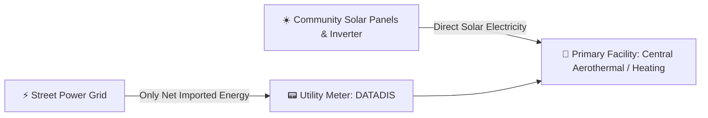
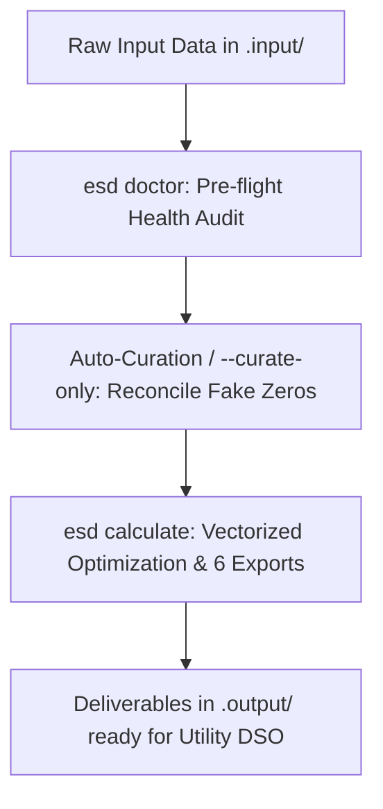

# 📘 Practical Guide to Electricity Share Distributor (`esd`)

> **Who this guide is for:** Homeowners associations (*comunidades de propietarios*), property managers (*administradores de fincas*), energy consultants, and building engineers who want to understand collective energy analytics and solar distribution across shared community facilities, without wading through dense mathematical formulas or legal jargon.

---

> [!IMPORTANT]
> ### 🛡️ Maintenance & Synchronization Harness
> **To developers and autonomous AI agents:** This document is the primary conceptual and operational guide for `electricity-share-distributor`. Whenever modifying ingestion schemas ([`src/ingestion/`](../src/ingestion)), curation logic ([`src/curation/`](../src/curation)), optimization models ([`src/optimization/`](../src/optimization)), CLI commands ([`src/cli.py`](../src/cli.py)), terminal views ([`src/presentation/views/`](../src/presentation/views)), or file exporters ([`src/presentation/export.py`](../src/presentation/export.py)), you **MUST** update this guide (`GUIDE_EN.md`) and its Spanish counterpart (`GUIDE_ES.md`) in tandem.

---

## 1. 🎯 What is the Real Purpose of `esd`?

`electricity-share-distributor` (`esd`) is a **unified CLI platform** for **residential community energy analytics and optimal collective photovoltaic distribution** across **shared common facilities within a single homeowners association (*comunidad de vecinos / propietarios*)** in Spain. It supports both pure DATADIS grid consumption audits (`esd summary`, `esd compare`) and full collective solar optimization (`esd doctor`, `esd calculate`) under Real Decreto 244/2019 & Orden TED/1247/2021.

### 🚫 What `esd` is NOT
- **`esd` is NOT meant to distribute solar energy or utility bills among private residential dwellings or individual apartments.**
- It does not compute private household billing splits between individual neighbors.

### 🏢 What `esd` IS
When a residential association monitors shared utility contracts or installs a collective rooftop PV array, `esd` evaluates load behavior across **shared common services** and distributes solar electricity across them:
1. **Central Aerothermal / Heating & Hot Water (*Aerotermia / Calefacción Central / ACS*):** Usually the heaviest thermal consumer in modern residential buildings.
2. **Swimming Pool & Community Hall (*Piscina y Sala Comunitaria*):** Filtration pumps, water treatment, summer lighting, and social room demand.
3. **Underground Garages (*Garaje*):** Continuous forced ventilation fans, carbon monoxide sensors, and 24/7 corridor lighting.
4. **Building Common Areas, Elevators & Staircases (*Ascensores, escaleras, alumbrado general*):** Hallway LED circuits, intercoms, and elevator traction motors.

---

## 2. ⚖️ Why Does a Single Community Need Distribution Coefficients?

Even though every shared facility belongs to the same *comunidad de propietarios*, Spanish electrical regulations treat each common service as an **independent supply point with its own utility contract and electricity meter (CUPS)**. Under **Real Decreto 244/2019** and **Orden TED/1247/2021**:
- The homeowners association files a formal distribution agreement with the electrical distributor (DSO / *distribuidora*) specifying what percentage ($\beta_i$) of hourly solar PV generation goes to each community meter.
- Coefficients across all participating community CUPS must sum to **strictly 100%** ($\sum \beta_i = 1.0$).
- Standard monthly agreements keep coefficients fixed across each calendar month; under **Orden TED/1247/2021**, communities may alternatively submit 24-hour diurnal profiles.

### Why Naive Splitting Causes Huge Financial Loss
Dividing generated solar electricity equally (e.g., $12.5\%$ to each of 8 community meters) or simply proportionally to annual invoices causes significant seasonal and diurnal financial waste:
- **Seasonal Mismatch (Pool vs. Heating):** In January, pool filtration sits idle while central aerothermal heat pumps run non-stop to heat the building. Giving the pool an equal winter share exports valuable midday PV electricity to the street grid for pennies while central heating buys expensive peak utility power.
- **Daily Mismatch (Lighting vs. Heat Pump):** Common area LEDs and intercoms draw minimal constant power, whereas central heat pumps run heavy compressor cycles during sunny midday hours. Analyzing hourly load profiles enables `esd` to assign solar generation where it lowers the community's overall bill most effectively.

---

## 3. 🔍 The Curation Process: Solving the "Fake Zero" Riddle

Before optimization can run, real-world community solar installations face a physical metering obstacle: **utility meters record "fake zeros" during sunny hours** because panels and the inverter sit wired directly behind the primary facility's utility meter (typically central aerothermal heating):



1. **Inside the Building:** During sunny daylight hours, the aerothermal plant runs directly on clean electricity produced on the rooftop.
2. **At the Utility Meter (DATADIS):** Utility meters measure only net electricity imported from the street distribution grid. Whenever rooftop generation meets local demand, DATADIS records **0.0 kWh**.
3. **The Optimization Trap:** Optimizing blindly on raw utility exports makes the building's primary equipment appear completely inactive during daylight hours, causing the algorithm to strip shares away from heating toward small circuits (like stair lighting) unable to consume them.

### How Curation Reconciles Reality (3-Stage Medallion Pipeline in [`src/curation/`](../src/curation))
`esd calculate` automatically runs curation whenever `.curated/esd.csv` is missing or out of sync with `cups.json` (`esd calculate --curate-only` writes styled Excel workbooks alongside CSVs):
1. **Stage 1 — Aggregate Generation (`generation.csv` & optional `.xlsx`):** Consolidates all solar inverter Excel reports in `.input/generation/` into a canonical `GenerationDataset` (`timestamp;year;month;day;hour;day_of_week;is_weekend;generation;consumption;self_consumption;exported_energy;imported_energy`).
2. **Stage 2 — Aggregate Consumption (`consumption.csv` & optional `.xlsx`):** Consolidates DATADIS CSV exports in `.input/consumption/` strictly for CUPS registered in [`.input/cups/cups.json`](../.input/cups/cups.json), enriching each row with its `use` label and excluding unconfigured meters in `ConsumptionDataset` (`timestamp;year;month;day;hour;day_of_week;is_weekend;cups_id;use;consumption`).
3. **Stage 3 — Build Master ESD Dataset (`esd.csv` & optional `.xlsx`):** Aligns common hours between generation and consumption for participating CUPS in `CuratedDataset`, resolves primary fake zeros, computes collective balances, and attaches local hourly weather context.

### The Curated Result (`.curated/esd.csv` and `.curated/esd.xlsx`)
#### 1. Standardized Master CSV (`esd.csv`)
Formatted using `;` delimiters and `,` decimals without thousands separators across four logical column groups:
1. **Temporal coordinates:** `timestamp`, `year`, `month`, `day`, `hour`, `day_of_week`, `is_weekend`
2. **Individual consumer:** `cups_id`, `use`, `consumption`
3. **Community & solar balance:** `community_demand`, `generation`, `self_consumption`, `exported_energy`, `imported_energy`
4. **Weather context:** `temperature`, `cloud_cover`, `weather_code`, `is_day`

```csv
timestamp;year;month;day;hour;day_of_week;is_weekend;cups_id;use;consumption;community_demand;generation;self_consumption;exported_energy;imported_energy;temperature;cloud_cover;weather_code;is_day
2026-05-01 12:00:00;2026;5;1;12;Friday;False;ES0021000000000001AA;Aerotermia;8,5;9,7;12,5;6,0;6,0;2,5;21,4;12;1;True
2026-05-01 12:00:00;2026;5;1;12;Friday;False;ES0021000000000002BB;Garaje;1,2;9,7;12,5;0,0;0,0;0,0;21,4;12;1;True
```

#### 2. Styled Streaming Excel Workbooks (`--curate-only` ➔ `esd.xlsx`, `generation.xlsx`, `consumption.xlsx`)
- **Semantic Group Header Colors:** Harmonized header fills distinguish Time (Steel Slate Blue), CUPS (Deep Petrol Teal), Demand (Warm Terracotta), Solar Generation/Balance (Solar Emerald), and Weather (Royal Amethyst).
- **Hour-Grouped Zebra Pattern:** Rows sharing the same hour alternate cleanly between pure white and soft grey (`#F4F6F9`) to visually group community meters per timestamp.
- **Boolean Badges, Freeze Panes & AutoFilter:** `is_weekend` and `is_day` render `✅`/`❌`, top headers stay frozen, and native Excel filters are enabled.

On the primary supply point, `esd` adopts $\max(C_{\text{DATADIS}}, C_{\text{inverter}})$ — non-destructively capturing full physical behind-the-meter demand without ever erasing positive fiscal DATADIS readings during inverter outages. The primary supply also records physically conserved plant flows ($SC_{\text{primary}, h} = \min(G_h, C_{\text{final}, h})$, `exported_energy`, and `imported_energy`), while secondary supplies carry zero individual plant flows before collective allocation. Records sort chronologically and alphabetically by facility `use`, and missing Open-Meteo years (`temperature` °C, `cloud_cover` 0–100%, WMO `weather_code`, `is_day` 0/1) are automatically downloaded from `cups.json` coordinates.

---

## 4. 🧠 Core Heuristics Explained (Without Complex Math)

### 1. Behind-the-Meter Fake Zero Detection & Telemetry Outage Resilience
On the primary CUPS, the inverter smart meter tracks actual equipment demand while behind-the-meter self-consumption drives utility grid imports toward zero. Four safeguards prevent telemetry glitches from distorting results:
- **Partial-Outage Sanitization:** If inverter PV yield drops mid-hour while the grid meter still exports ($G_{\text{FV}} < E_{\text{exported}}$), corrupted partial-hour production and false-zero inverter consumption are sanitized before optimization.
- **Zero-Dropout Guard:** Primary reconciliation ($\max(C_{\text{DATADIS}}, C_{\text{inverter}})$) never overwrites positive fiscal DATADIS readings with inverter zeros caused by communication drops.
- **Fortnight Outage Fallback (`MIN_FORTNIGHT_SOLAR_DAYS = 5`):** Any fortnight (`01-1`..`12-2`) with fewer than 5 solar days falls back automatically to full-month optimal $\beta_i$ coefficients rather than overfitting a single partial day.
- **Pre-Flight Outage Audit (`esd doctor`):** Issues a diagnostic warning whenever solar generation has $\ge 48$ consecutive hours of zero production.

### 2. Forward-Looking Calendar Schedule (January to December)
Because communities sign DSO agreements for an **upcoming operating year** rather than historical billing periods, `esd` organizes results into a uniform 12-month January–December calendar matrix.

### 3. Complete Month Quality Threshold (The 90% Rule)
Commissioning a plant mid-month (e.g., June 20th) leaves too few days to extrapolate permanent shares:
- Each historical month must span continuously past day 27 and cover **at least 90% of expected calendar hours**.
- Incomplete months are cleanly skipped (`—`) rather than biasing coefficients with partial samples.

### 4. Multi-Year Seasonal Pooling & Per-Month $1/k_m$ Calendar Scaling
Weather varies year to year — a cloudy May in 2025 followed by a sunny May in 2026 shouldn't skew community planning. Across multi-year histories, `esd` pools all complete observations per calendar month and scales aggregated solar generation, demand, self-consumption, and surplus by exact per-month multiplicity **$1/k_m$** (where $k_m$ counts complete observed years in calendar month $m$, or matching fortnight/hour buckets). Uneven partial-year records (e.g., two Septembers and one January) never bias the normalized year.

### 5. Exact 100% Rounding (The Hare-Niemeyer Method)
Electrical DSOs reject filings unless percentages add up strictly to **100%**:
- Conventional decimal rounding often sums to 99% or 101% due to accumulated rounding drift.
- **Hare-Niemeyer Largest Remainder rounding** assigns truncated floor quotas first and distributes remaining units to the largest fractional remainders until shares sum **strictly to 100%** at `0`, `1`, or `2` decimal places.

### 6. Cloud-Resilient Hourly Profiles & Night Allocation
Brief cloud lulls can inflate raw ratios on intermittent circuits like elevator motors. During `esd calculate`, the 24-hour diurnal engine consolidates all days into observed (`share_pct`) and smoothed filing (`estimated_share_pct`) profiles under **Orden TED/1247/2021**. In zero-generation night intervals, each participating CUPS receives an active **1% floor** (or `min_share`) with the remaining percentage allocated to the primary CUPS (e.g., 99%/1%), preserving continuous active participation at 100%.

### 7. Photovoltaic Solar Efficiency Index (SEI)
In `*_esd_hourly_shares.csv`, each row includes an integer `solar_efficiency` score (`0` when $G_h = 0$; `1`–`100` when $G_h > 0$) modeling panel physics and solar geometry from Open-Meteo weather:
$$\text{SEI} = \begin{cases} \text{clip}\left(\text{round}\left(100.0 \times f_{\text{cloud}} \times f_{\text{temp}} \times f_{\text{season}} \times f_{\text{hour}}\right), \; 1, \; 100\right) & \text{if } G_h > 0 \\ 0 & \text{if } G_h = 0 \end{cases}$$
- **Cloud Optical Attenuation ($f_{\text{cloud}}$):** Non-linear beam extinction preserving ~25% diffuse irradiance under overcast skies: $f_{\text{cloud}} = 1.0 - 0.75 \times \left(\frac{CC}{100.0}\right)^{1.2}$.
- **Cell Temperature Derating ($f_{\text{temp}}$):** Silicon thermal coefficient ($-0.4\% / ^\circ\text{C}$ vs. $20^\circ\text{C}$), boosting cool bright mornings (to $+8\%$) while derating hot afternoons: $f_{\text{temp}} = \text{clip}\left(1.0 - 0.004 \times (T_{\text{amb}} - 20.0), \; 0.80, \; 1.08\right)$.
- **Seasonal Solar Elevation ($f_{\text{season}}$):** Latitude declination & air mass across Spain (36°N–43°N, June ~1.00, Dec ~0.70): $f_{\text{season}} = 0.85 + 0.15 \times \cos\left(\frac{2\pi \times (m - 6.5)}{12.0}\right)$.
- **Diurnal Zenith Angle ($f_{\text{hour}}$):** Fixed rooftop cosine incidence peaking near solar noon (13:00–14:00): $f_{\text{hour}} = \begin{cases} 0.70 + 0.30 \times \sin\left(\pi \times \frac{h - 6.0}{15.0}\right) & \text{if } 6 \le h \le 21 \\ 0.65 & \text{otherwise} \end{cases}$.

### 8. Community Bylaw Bounds (*Estatutos*)
HOA agreements frequently impose statutory bounds directly in `.input/cups/cups.json`:
- **Minimum Share Floor (`"min_share"`):** Guarantees minor common circuits (garage fans, elevators, lighting) a minimum quota (e.g., `0.05` = 5%).
- **Maximum Share Cap (`"max_share"`):** Caps dominant facilities (e.g., central heat pump at `0.70` = 70%).
- **Uniform Constraint Enforcement:** Optimization solvers check feasibility ($\sum L_i \le 1.0$) and enforce $L_i \le \beta_i \le U_i$ alongside Hare-Niemeyer rounding across monthly, fortnight, and hourly schedules.

### 9. European DST Transitions & Autumn Energy Conservation
Continental Spain observes European Daylight Saving Time (23h on the last Sunday of March and 25h on the last Sunday of October):
- **Autumn Repeated Hour (`02:00` CEST/CET):** When clocks step back, DATADIS exports and inverter Excel logs both contain two separate `02:00` entries on that switchback date.
- **Zero-Loss Within-File Consolidation:** Before merging overlapping files, `consolidate_autumn_dst` sums the two intra-day `02:00` intervals inside each source file so 100% of 25-hour autumn energy is preserved without double counting overlapping exports.

---

## 5. 📊 Community Energy Balance & 4-Way Progression

To give property owners and HOA boards complete transparency, `esd` reports a six-KPI energy balance and four-tier progression across console views, interactive HTML dashboards, and CSV exports.

### The Six Core Energy Balance KPIs
1. **Total Solar Generation ($G_{\text{total}}$):** Aggregate kilowatt-hours generated by the PV installation over the evaluation period.
2. **Total Community Demand ($C_{\text{total}}$):** Full 24/7 electricity demanded by all participating common community facilities.
3. **Solar-Hours Generation ($G_{\text{solar}}$):** Generation during active daylight intervals ($G_h > 0$), confirming zero nocturnal distortion.
4. **Solar-Hours Demand ($C_{\text{solar}}$):** Aggregate community demand during solar hours ($G_h > 0$), defining the physical instantaneous self-consumption limit without battery storage.
5. **Solar Surplus Spilled ($Surplus$):** Excess PV generation exceeding simultaneous community demand ($\max(0, G_h - C_h)$), exported to the street grid.
6. **Total Self-Consumed Energy ($SC$):** Clean solar kilowatt-hours captured directly by community equipment on-site ($\min(C_h, G_h)$), displacing utility purchases.

### The 4-Way Self-Consumption Modality Progression
Evaluated consistently via per-month $1/k_m$ calendar normalization:
1. **Current Self-Consumption (Baseline / No Share):** Direct behind-the-meter self-consumption recorded on the primary supply meter alone ($SC_{\text{primary}, h}$).
2. **Monthly Share (Real Decreto 244/2019):** Fixed monthly coefficients $\beta_{i,m}$ adapting shares across seasonal heating and swimming pool cycles.
3. **Fortnight Share (24 Half-Months):** Bi-monthly $\beta_i$ schedules for days `1–15` and `16–end` per month (`MIN_FORTNIGHT_SOLAR_DAYS = 5` fallback).
4. **Dynamic Hourly Share (Orden TED/1247/2021):** 24-hour diurnal $\beta_{i,h}$ profiles maximizing instantaneous generation-consumption overlap.

---

## 6. 🚀 Practical Workflow & Commands

### Track A: Consumption-Only Community Analytics (`esd summary` & `esd compare`)
Communities auditing grid consumption alone place DATADIS CSV exports flat in `.input/consumption/*.csv` or annualized `.input/consumption/<year>/*.csv` subdirectories (`consumo_kWh`/`consumoKwh` pre-validated by `DatadisValidator`); `cups.json` is optional for `use` labels:
```bash
esd summary [--year 2025] [--view all|annual|monthly] [--cups ES0021000000000001AA]
esd compare [-y 2024 -y 2025] [--no-charts] [--html]
```
- **Exact 100.00% Fair Shares & Badges:** Annual/monthly shares sum strictly to `100.00%`; `★` highlights rank #1 (`>30%`), and `(0)` marks inactive meters (`<1 kWh`). (`esd summary` displays compact annual + monthly summaries by default; pass `--view monthly` to inspect per-CUPS monthly tables.)
- **Apples-to-Apples `[Inc]` Heuristic & Native SVGs:** `esd compare` marks months below 90% hours or ending on/before day 27 as `[Inc]` across all compared years, excluding them from YoY totals/deltas, and writes grouped SVG bar charts in `.output/charts/` plus optional standalone `--html` dashboards.

### Track B: Collective PV Optimization Pipeline (`esd init` ➔ `esd doctor` ➔ `esd calculate`)


### Step 1: Initialize Workspace & Config (`esd init` / `esd config`)
Creates `.input/`, `.curated/`, and `.output/`, configures UI language (`en`/`es`), decimal precision (`0`/`1`/`2`), Open-Meteo coordinates (`--latitude`/`--longitude`), and folder or `cups.json` paths (`--cups-file`) once in `.esd_config.json` (shared automatically across `doctor`, `summary`, `compare`, `calculate`, and `clean`):
```bash
esd init [--lang en|es] [--precision 0|1|2]
esd config [--lang es] [--precision 2] [--latitude 40.4168 --longitude -3.7038] [--cups-file .input/cups/cups.json]
```

### Step 2: Check Data Health (`esd doctor`)
Audits DATADIS CSVs, solar inverter `.xlsx` exports, and Open-Meteo archives for gaps, duplicates, inactive meters, prolonged inverter outages (`>=48h`), and timestamp overlap. Runs gracefully in **consumption-only mode** if `.input/generation/` is empty (`can_calculate=False`, exits `1`):
```bash
esd doctor [--verbose]
```

### Step 3: Automatic Curation, Weather Fetching & PV Optimization (`esd calculate`)
`esd calculate` runs using your persistent configuration in `.esd_config.json`, evaluates strictly the participating CUPS configured in `.input/cups/cups.json`, computes monthly, fortnight (24 half-month periods), and dynamic 24-hour diurnal distribution coefficients via vectorized water-filling (cross-verified against SciPy's HiGHS LP solver), renders 80-column terminal summary, trajectory, and matrix tables, and writes all **6 `.output/` deliverables**:

> [!TIP]
> **Automatic Curation & Weather Downloads:** You do not need to run separate preparation commands. Whenever `.curated/esd.csv` is missing or out of sync with `cups.json`, `esd calculate` automatically executes the 3-stage curation pipeline first and fetches any missing Open-Meteo historical weather archives (deduplicating repeated community coordinates across CUPS and storing `{YYYY}_{lat}_{lon}_weather.csv`). Pass `--refresh` to force fresh Open-Meteo downloads and full re-curation, or `--curate-only` to generate `.curated/*.csv` and sibling styled Excel workbooks without running optimization.

Example `.input/cups/cups.json` configuration (synthetic identifiers only, with optional `min_share`/`max_share` bylaws and coordinates):
```json
[
  {"cups": "ES0021000000000001AA", "use": "Aerotermia", "primary": true, "latitude": 40.4168, "longitude": -3.7038},
  {"cups": "ES0021000000000002BB", "use": "Garaje", "min_share": 0.05, "max_share": 0.40}
]
```

```bash
esd calculate                 # Auto-curate if needed + optimize + export 6 deliverables
esd calculate --refresh       # Re-fetch Open-Meteo weather & force full re-curation
esd calculate --curate-only   # Build CSV & styled Excel datasets in .curated/ only
```

### Step 4: Clean Up Generated Files (`esd clean`)
Recursively removes artifacts from `.output/`, `.curated/`, and `.input/weather/` (preserving `.gitkeep`):
```bash
esd clean [--force]
```

---

## 7. 📊 Deliverables & Official Documents (`.output/`)

| File Name | Format | Source Command & Practical Purpose |
| :--- | :--- | :--- |
| `*_esd_interactive_report.html` | HTML (Standalone) | `calculate`: Accessible 6-chapter EN/ES community CUPS storytelling report (`esd.csv` primary weather + pre-solar CSV fallback) with clean editorial header, interactive 4-column active CUPS table (`cups.json`, latest complete year ref. consumption), Consumption, Weather (Day Types by daylight WMO `weather_code` + Weather–Energy cross-insights) & Generation line graphs (`[Inc]` aware), redesigned Y-split behind-the-meter diagram, Winter vs. Summer spotlight, Monthly Balance legend, 4-step collective sharing story, everyday CO₂/household equivalences, 12-term glossary with localized new-tab external links, Light/Dark/High-Contrast themes & text-size controls. |
| `*_esd_monthly_shares.csv` | CSV (`;`) | `calculate`: Monthly allocation breakdown per CUPS: consumption, generation, share percentage ($\beta_i$ %), self-consumed kWh, solar surplus & remaining grid demand ordered by month and `use`. |
| `*_esd_monthly_shares_lite.csv` | CSV (`;`) | `calculate`: Compact monthly $\beta_i$ % matrix with CUPS (`cups`, `use`) on the Y axis and months (`01`..`12`) on the X axis. |
| `*_esd_fortnight_shares.csv` | CSV (`;`) | `calculate`: Fortnight (`1`: days 1–15, `2`: days 16–end) allocation breakdown per CUPS with monthly half-period balances. |
| `*_esd_fortnight_shares_lite.csv` | CSV (`;`) | `calculate`: Compact fortnight $\beta_i$ % matrix with CUPS (`cups`, `use`) on the Y axis and fortnights (`01-1`..`12-2`) on the X axis. |
| `*_esd_hourly_shares.csv` | CSV (`;`) | `calculate`: Full hourly series recording consumption, generation, shares (1% active floor) and integer Solar Efficiency Index (`0`–`100`). |
| `*_esd_consumption_summary.md` | Markdown | `summary`: Executive report with annual/monthly 100.00% fair-share rankings, `★`/`(0)` consumer badges, ASCII bars & seasonality insights. |
| `*_esd_consumption_comparison.md` & `charts/*.svg` | Markdown + Native SVG | `compare`: Multi-year apples-to-apples comparison excluding `[Inc]` months, paired with grouped SVG charts in `.output/charts/` & optional `--html` dashboard (`*_esd_comparison_report.html`). |

---

## 8. 🗺️ Code Map & Traceability Reference

| Architecture Layer | Module | Key Classes / Functions | Responsibility |
| :--- | :--- | :--- | :--- |
| **CLI & Commands** | [`src/cli.py`](../src/cli.py) | `init_command`, `doctor_command`, `summary_command`, `compare_command`, `calculate_command`, `config_command`, `clean_command` | Lazy-loaded 7-command Typer dispatch, `-V`/`-h`, and workflow control. |
| **Application Services** | [`src/services/`](../src/services) | `CalculationService`, `SummaryService`, `ComparisonService`, `CurationService`, `DoctorService`, `WeatherService` | Business workflow orchestrators decoupling analytics & PV optimization from CLI. |
| **Consumption Analytics** | [`src/analytics/`](../src/analytics) | `aggregate_consumption`, `compare_years`, `get_complete_months` | Exact 100.00% fair-share aggregation and `[Inc]` YoY comparison engine. |
| **Domain Core** | [`src/domain/`](../src/domain) | `SupplyPoint`, `BylawConstraints`, `EsdError` | Domain models, bylaw bounds, and centralized typed exceptions. |
| **Config & Localization** | [`src/config.py`](../src/config.py), [`src/i18n.py`](../src/i18n.py) | `AppConfig`, `load_config`, `t()`, `TRANSLATIONS` | `.esd_config.json` persistence, directory resolution & strict EN/ES namespaces. |
| **Ingestion: Consumption** | [`src/ingestion/consumption.py`](../src/ingestion/consumption.py) | `DatadisConsumptionLoader`, `DatadisValidator` | Pre-validation, recursive `<year>/` discovery, DST conservation & CSV reading. |
| **Ingestion: Generation** | [`src/ingestion/generation.py`](../src/ingestion/generation.py) | `HuaweiGenerationLoader` | Streaming read-only `.xlsx` parsing (PV yield, plant load, DST conservation). |
| **Ingestion: Weather & Audit** | [`src/ingestion/weather.py`](../src/ingestion/weather.py), [`doctor.py`](../src/ingestion/doctor.py) | `OpenMeteoWeatherDownloader`, `WeatherLoader`, `DataDoctor` | Open-Meteo archive downloads, weather CSV parsing & health/gap diagnostics. |
| **Curation & Alignment** | [`src/curation/`](../src/curation), [`aligner.py`](../src/ingestion/aligner.py) | `DataCurator`, `TimeSeriesAligner`, `GenerationDataset`, `ConsumptionDataset`, `CuratedDataset` | 3-stage aggregation, primary reconciliation, weather join & `.curated/` export. |
| **Optimization** | [`src/optimization/`](../src/optimization) | `DistributionOptimizer`, `CoefficientsMatrix`, `HourlyProfileMatrix` | Vectorized water-filling solver (HiGHS verified), $1/k_m$, 4-way & Hare-Niemeyer. |
| **Presentation & Export** | [`src/presentation/`](../src/presentation) | `views/`, `charts.py`, `story_data.py`, `story_report.py`, `html_report.py`, `ReportExporter` | PEP 562 lazy 80-col Rich views, SVG charts, storytelling HTML & streaming `.xlsx`/CSV/MD. |
| **Security & Versioning** | [`src/security.py`](../src/security.py), [`src/version.py`](../src/version.py) | `check_privacy`, `scan_xlsx_file`, `scan_git_history`, `bump` | GDPR CUPS/coords/path/secret scanner and per-commit CalVer manager. |
