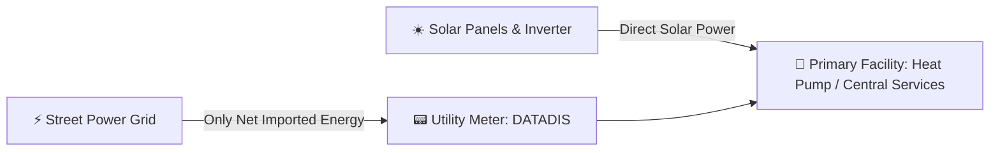
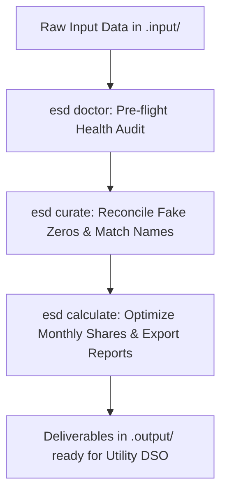

# 📘 Practical Guide to Electricity Share Distributor (`esd`)

> **Who this guide is for:** Community members, building managers, energy consultants, and developers who want to understand how collective solar distribution works in practice, without wading through dense mathematical formulas or legal jargon.

---

> [!IMPORTANT]
> ### 🛡️ Maintenance & Synchronization Harness
> **To developers and autonomous AI agents:**
> This document is the primary conceptual and operational guide for `electricity-share-distributor`.
> Whenever modifying the data ingestion schemas ([`src/ingestion/`](../src/ingestion)), curation logic ([`src/curation/`](../src/curation)), optimization solver ([`src/optimization/`](../src/optimization)), terminal presentation ([`src/presentation/views.py`](../src/presentation/views.py)), or file exporters ([`src/presentation/export.py`](../src/presentation/export.py)), you **MUST** update this guide (`GUIDE_EN.md`) and its Spanish counterpart (`GUIDE_ES.md`) in tandem.

---

## 1. 🎯 What is Collective Self-Consumption & Why Do We Need Optimization?

When an apartment building or community in Spain installs rooftop solar panels under **Real Decreto 244/2019**, all participating supply points (each identified by a unique code called a **CUPS**) share the electricity generated by the single shared installation.

### The Regulatory Rule: Fixed Monthly Percentages
The Spanish electrical regulations require all participants to agree on a fixed percentage share of the solar energy for each calendar month.
- Every participant receives their agreed share of whatever the panels produce in each hour.
- The shares of all participants must add up to **exactly 100%**.
- Once set, these shares remain constant for the entire calendar month.

### Why Simple Splitting Fails
It might seem intuitive to split the energy equally (e.g., 25% each among 4 neighbors) or in proportion to everyone's total monthly electric bill. However, this causes massive financial waste:
- **The Empty Apartment Problem:** If a neighbor works outside all day or travels frequently, an equal solar share assigned to them at 1:00 PM is wasted. It gets dumped onto the electrical grid as surplus, paid at cheap wholesale prices.
- **The Active Consumer Problem:** At the exact same time, a neighbor working from home or running heat pumps is forced to buy expensive electricity from the utility company because their solar share was too small.

**How `esd` solves this:** The tool analyzes hour-by-hour historical curves and automatically finds the distribution percentages that maximize the solar energy consumed inside the community, minimizing electricity bought from the street.

---

## 2. 🔍 The Curation Process: Solving the "Fake Zero" Riddle

Before calculating fair shares, we face a major real-world data challenge: **utility meters lie during sunny hours**.

### Why Utility Data Has "Fake Zeros"
In almost all community solar installations, the solar panels and their inverter are physically connected right behind one primary meter (for example, the community heat pump, aerothermal system, or central services meter):



1. **Inside the Building:** During daylight hours, the heat pump consumes electricity generated directly by the solar panels on the roof.
2. **At the Utility Meter (DATADIS):** The utility meter only measures electricity imported from the street. Because solar power satisfies the demand internally, the utility meter sees zero power coming from the grid and records **0.0 kWh**.
3. **The Trap:** If you optimize based solely on utility data, the primary facility looks completely inactive during the day. The tool would mistakenly take solar energy away from the building's biggest consumer and give it to others who cannot use it!

### How `esd curate` Reconciles the Truth
The curation engine ([`src/curation/`](../src/curation)) reconciles two separate data sources to recover the true physical consumption:

1. **Utility Data (DATADIS):** Hourly consumption imported from the grid for each neighbor.
2. **Solar Inverter Data (Huawei FusionSolar):** The inverter measures both the solar yield and the *actual electrical demand* of the equipment connected directly behind it.
3. **Friendly Names ([`.input/cups/cups.json`](../.input/cups/cups.json)):** Matches 20-character technical CUPS codes to human-friendly descriptions (e.g., `"Aerotermia"`, `"Pool"`, `"Garage"`, `"Portal 1"`), and marks which one is the `"primary": true` connection point.

Whenever the utility meter reports zero (or artificially low power) while the inverter reports that the equipment was actively running, `esd curate` **replaces the fake zero with the real consumption**.

### The Curated Result (`.curated/curated.csv`)
The output is a single, clean, standardized table:
```csv
timestamp,generation,cups_id,use,consumption,primary,reconciled
2026-05-01 12:00:00,12.5,ES0021000000000001AA,Aerotermia,8.5,True,True
2026-05-01 12:00:00,12.5,ES0021000000000002BB,Garage,1.2,False,False
```
Every row clearly indicates whether a reading was reconciled, ensuring 100% transparency and auditability.

---

## 3. 🧠 Core Heuristics Explained (Without Complex Math)

`esd` incorporates several practical rules to make the calculation robust against real-world imperfections:

### 1. Behind-the-Meter Fake Zero Detection
For the supply point designated as primary, whenever the solar inverter records that equipment was actively consuming energy during hours with solar production, `esd` checks if the utility reported zero or significantly less power. If so, it restores the inverter's true reading and records the exact kWh recovered.

### 2. Forward-Looking Calendar Schedule (January to December)
Communities don't sign agreements to distribute energy in the past; they need a distribution schedule for an **upcoming operating year**. `esd` always structures its results as a clean 12-month calendar matrix running from January through December.

### 3. Complete Month Quality Threshold (The 90% Rule)
If a solar installation was turned on midway through a month (for example, on June 20th), optimizing a permanent monthly percentage based on just 10 days would produce an unfair, distorted result.
- `esd` checks that each historical month has readings spanning from the start to the end of the month, covering **at least 90% of expected calendar days and hours**.
- If a month does not meet this quality standard, the tool skips that month and displays a clean dash (`—`) rather than guessing with incomplete data.

### 4. Multi-Year Seasonal Pooling
Weather varies from year to year. A rainy May in 2025 followed by a scorching May in 2026 shouldn't cause confusion. When historical data is available for the same calendar month across multiple years, `esd` pools all hourly observations together. This blends out short-term weather anomalies and creates a balanced, representative profile for future years.

### 5. Exact 100% Rounding (The Hare-Niemeyer Method)
Electrical distribution companies (DSOs) reject regulatory share filings if the percentages do not sum to **exactly 100%**.
- Standard mathematical rounding often creates sums of 99% or 101% due to accumulated fractional decimals.
- `esd` uses the **Largest Remainder Method** (Hare-Niemeyer): it gives every participant their integer share first, and then allocates the remaining decimal fractions to the participants with the largest remainders until the sum is **strictly 100%** across any chosen precision (0, 1, or 2 decimal places).

### 6. Cloud-Resilient Hourly Profiles
On cloudy or stormy days, solar production can drop to near zero. If a single resident turns on a microwave during a momentary solar lull, calculating an instantaneous percentage would assign them an absurdly high share (like 95%) that doesn't reflect typical habits.
- The 24-hour diurnal profile (`--hourly`) calculates average hourly patterns across all observed days.
- It provides both the actual share and a cloud-resilient estimated share that protects participants from momentary weather distortions.
- **Night Hours with Exact Zero Generation:** In night hours where solar generation is exactly zero, 100% of the share is assigned to the primary installation CUPS (and 0% to non-primary participants). This avoids distributing meaningless fractions of zero energy among residents while maintaining an exact regulatory 100% sum.

---

## 4. 🚀 Practical Workflow & Commands

You can execute the entire pipeline with simple commands:



### Step 1: Check Data Health (`esd doctor`)
Scans all DATADIS CSV files and Huawei Excel reports to detect gaps, inactive meters, and overlapping date ranges before doing any math:
```bash
esd doctor
```

### Step 2: Automatic or Manual Curation (`esd curate`)
Reconciles the fake zeros from the primary meter and outputs `.curated/curated.csv`:
```bash
esd curate
```
> [!TIP]
> **Automatic Curation:** You do not even need to run `esd curate` manually! When you run `esd calculate`, the tool checks if `.curated/curated.csv` exists. If it's missing, it automatically curates the data first.

### Step 3: Calculate Optimal Shares (`esd calculate`)
Solves the optimal distribution schedule and displays clean 80-column terminal tables:
```bash
# Calculate full 12-month calendar schedule
esd calculate

# Filter to a specific year and month
esd calculate --year 2026 --month 5

# Include 24-hour diurnal profile and hourly time-series
esd calculate --hourly

# Set share percentage precision (0 = 53%, 1 = 52.8%, 2 = 52.86%)
esd calculate --precision 1
```

---

## 5. 📊 Deliverables & Official Documents (`.output/`)

Running `esd calculate` generates ready-to-use artifacts in `.output/`:

| File Name | Format | Practical Purpose |
| :--- | :--- | :--- |
| `*_esd_coefficients_matrix.csv` | CSV (`;` delimited) | Ready-to-import spreadsheet table formatted for official submission to the electrical utility distributor (DSO). |
| `*_esd_optimization_summary.md` | Markdown | Executive summary report including the community agreement annex ready for neighbor signatures. |
| `*_esd_coefficients.csv` | CSV (`;` delimited) | Detailed breakdown per CUPS: monthly self-consumed kWh, solar surplus, and remaining grid demand. |
| `*_esd_results.json` | JSON | Machine-readable data file for software integrations and dashboards. |
| `*_esd_hourly_shares.csv` | CSV (`;` delimited) | Full hourly time-series recording consumption, generation, and actual vs. estimated shares. |
| `*_esd_hourly_profile_matrix.csv` | CSV (`;` delimited) | 24-hour diurnal table for variable hourly coefficient filing under Spanish regulation (Orden TED/1247/2021). |

---

## 6. 🗺️ Code Map & Traceability Reference

For developers and agents navigating the codebase:

| Architecture Layer | Module | Key Classes / Functions | Responsibility |
| :--- | :--- | :--- | :--- |
| **CLI & Commands** | [`src/cli.py`](../src/cli.py) | `calculate_command`, `curate_command`, `doctor_command` | Typer command routing, parameter validation, and user workflow dispatch. |
| **Configuration** | [`src/config.py`](../src/config.py) | `AppConfig`, `get_language`, `get_precision` | Settings persistence (`.esd_config.json`) and folder resolution. |
| **Localization** | [`src/i18n.py`](../src/i18n.py) | `t()`, `TRANSLATIONS` | English and Spanish dictionary lookups with string interpolation. |
| **Ingestion: Consumption** | [`src/ingestion/consumption.py`](../src/ingestion/consumption.py) | `DatadisConsumptionLoader` | DATADIS CSV discovery, encoding detection, and reading. |
| **Ingestion: Generation** | [`src/ingestion/generation.py`](../src/ingestion/generation.py) | `HuaweiGenerationLoader` | Huawei FusionSolar `.xlsx` parsing (solar production and load demand). |
| **Ingestion: Audit** | [`src/ingestion/doctor.py`](../src/ingestion/doctor.py) | `DataDoctor`, `DoctorReport` | Pre-flight gap detection, inactive meter alerts, and date overlap verification. |
| **Curation & Reconciliation** | [`src/curation/`](../src/curation) | `DataCurator`, `CuratedDataset` | Fake-zero reconciliation, CUPS metadata lookup, and curated CSV export. |
| **Optimization: Models** | [`src/optimization/models.py`](../src/optimization/models.py) | `CoefficientsMatrix`, `HourlyProfileMatrix`, `OptimizationResult` | Matrix structures, diurnal profiles, and community metrics. |
| **Optimization: Solver** | [`src/optimization/engine.py`](../src/optimization/engine.py) | `DistributionOptimizer` | Linear programming solver, diurnal profile engine, baselines, and Hare-Niemeyer rounding. |
| **Presentation: Views** | [`src/presentation/views.py`](../src/presentation/views.py) | `render_coefficients_matrix_table`, `render_community_summary` | Rich terminal tables, adaptive 80-column formatting, and curation summaries. |
| **Presentation: Exports** | [`src/presentation/export.py`](../src/presentation/export.py) | `export_all`, `export_hourly_shares_csv` | Markdown summary generation, CSV spreadsheets, and JSON serialization. |
| **Security & Privacy** | [`src/security.py`](../src/security.py) | `CupsPrivacyChecker`, `scan_git_history` | GDPR enforcement and synthetic CUPS verification harness. |
