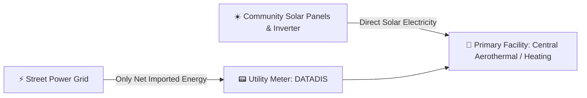
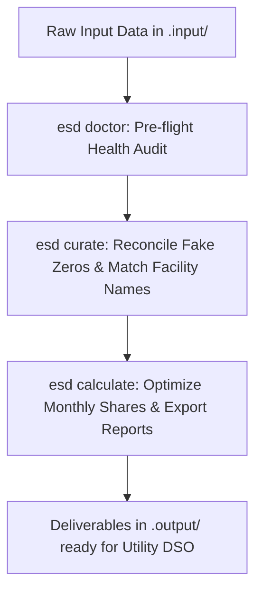

# 📘 Practical Guide to Electricity Share Distributor (`esd`)

> **Who this guide is for:** Homeowners associations (*comunidades de propietarios*), property managers (*administradores de fincas*), energy consultants, and building engineers who want to understand how collective solar distribution works across shared community facilities, without wading through dense mathematical formulas or legal jargon.

---

> [!IMPORTANT]
> ### 🛡️ Maintenance & Synchronization Harness
> **To developers and autonomous AI agents:**
> This document is the primary conceptual and operational guide for `electricity-share-distributor`.
> Whenever modifying the data ingestion schemas ([`src/ingestion/`](../src/ingestion)), curation logic ([`src/curation/`](../src/curation)), optimization solver ([`src/optimization/`](../src/optimization)), terminal presentation ([`src/presentation/views/`](../src/presentation/views)), or file exporters ([`src/presentation/export.py`](../src/presentation/export.py)), you **MUST** update this guide (`GUIDE_EN.md`) and its Spanish counterpart (`GUIDE_ES.md`) in tandem.

---

## 1. 🎯 What is the Real Purpose of `esd`?

`electricity-share-distributor` (`esd`) is a **unified CLI platform** for **residential community energy analytics and optimal collective photovoltaic distribution** across **shared common facilities within a single homeowners association (*comunidad de vecinos / propietarios*)** in Spain. Consolidating the capabilities of `datadis-analyzer` (`da`) directly into `esd`, it serves both communities analyzing pure DATADIS grid consumption (`esd summary`, `esd compare`) and communities optimizing collective solar generation (`esd doctor`, `esd curate`, `esd calculate`) under Real Decreto 244/2019 & Orden TED/1247/2021.

### 🚫 What `esd` is NOT:
- **`esd` is NOT meant to distribute energy or bills to private residential dwellings or individual apartments.**
- It does not calculate private domestic consumption splits between neighbors.

### 🏢 What `esd` IS:
When a residential community monitors shared utility contracts or installs a shared rooftop photovoltaic (PV) system, `esd` helps understand demand across **collective facilities and common services**, and allocate generated solar electricity across them:
1. **Central Aerothermal / Heating & Hot Water (*Aerotermia / Calefacción Central / ACS*):** Typically the largest energy consumer in modern buildings.
2. **Swimming Pool & Community Hall (*Piscina y Sala Comunitaria*):** Filtration pumps, water treatment, lighting, and summer recreational demand.
3. **Underground Garages (*Garaje*):** Continuous ventilation systems, carbon monoxide extractors, and 24/7 lighting.
4. **Building Common Areas, Elevators & Staircases (*Ascensores, escaleras, alumbrado general*):** Hallway lighting, building intercoms, and elevator traction motors.

---

## 2. ⚖️ Why Does a Single Community Need Distribution Coefficients?

Even though all these shared services belong to the exact same *comunidad de propietarios*, Spanish electrical regulations treat each one as an **independent supply point with its own utility contract and electricity meter (CUPS)**.

Under **Real Decreto 244/2019** and **Orden TED/1247/2021**:
- The community must register a formal agreement with the electrical distribution company (DSO / *distribuidora*) specifying what percentage ($\beta_i$) of the solar energy generated each hour is allocated to each community meter.
- The coefficients across all participating community meters must add up to **strictly 100%** ($\sum \beta_i = 1.0$).
- Under standard monthly filing, these percentages remain constant throughout each calendar month. Alternatively, a 24-hour diurnal schedule can be filed under Orden TED/1247/2021.

### Why Naive Splitting Causes Huge Financial Loss:
It might seem simple to divide the solar power equally (e.g., $12.5\%$ to each of 8 community meters) or according to their annual bill. However, this causes severe financial waste:
- **The Seasonal Mismatch (Pool vs. Heating):** In January, the swimming pool filtration is shut down, while the central aerothermal heat pump works non-stop to heat the building. Assigning equal solar shares to the pool in winter spills valuable solar electricity into the street as surplus for pennies, while the community's heat pump is forced to purchase expensive peak grid electricity!
- **The Daily Mismatch (Lighting vs. Garage vs. Heat Pump):** Common area lighting uses very little baseline power (efficient LED bulbs and intercoms), while the central heat pump runs heavy compressor cycles during sunny midday hours. An equal split leaves lighting circuits with unused excess solar energy and starves the central heating.

**How `esd` Solves This:** The optimization engine analyzes hour-by-hour consumption curves across all community services and finds the exact mathematical coefficients that maximize self-consumption inside the community, drastically cutting the association's total electricity bill.

---

## 3. 🔍 The Curation Process: Solving the "Fake Zero" Riddle

Before calculating optimal shares, real-world community solar installations face a major measurement obstacle: **utility meters record "fake zeros" during sunny hours**.

### Why Utility Data Has Fake Zeros
In most community installations, the solar panels and inverter are physically wired right behind the meter of the primary facility (typically the central aerothermal heating or central services room):



1. **Inside the Community:** During sunny daylight hours, the aerothermal system runs directly on clean electricity generated by the rooftop panels.
2. **At the Utility Meter (DATADIS):** The utility meter only records electricity drawn from the street grid. Because solar power satisfies the demand on-site, the utility meter records **0.0 kWh**.
3. **The Trap:** If you optimize based solely on utility data, the community's primary facility looks completely inactive during the day! The algorithm would mistakenly strip solar shares away from the building's biggest consumer and reassign them to small meters (like staircase lighting) that cannot use the power.

### How `esd curate` Reconciles the Physical Reality (3-Stage Data Pipeline)
The curation engine ([`src/curation/`](../src/curation)) applies a 3-stage Medallion data pipeline using canonical domain models decoupled from vendor formats:

1. **Stage 1 — Aggregate Generation (`generation.csv` & `generation.xlsx`):** Consolidates all solar inverter Excel files in `.input/generation/` into a single canonical `GenerationDataset` (`timestamp;year;month;day;hour;day_of_week;is_weekend;generation;consumption;self_consumption;exported_energy;imported_energy`).
2. **Stage 2 — Aggregate Consumption (`consumption.csv` & `consumption.xlsx`):** Consolidates DATADIS CSV files in `.input/consumption/` for the participating CUPS defined in [`.input/cups/cups.json`](../.input/cups/cups.json) into a single canonical `ConsumptionDataset` (`timestamp;year;month;day;hour;day_of_week;is_weekend;cups_id;use;consumption`), enriched with facility descriptions and excluding any unconfigured supply points.
3. **Stage 3 — Build Master ESD Dataset (`esd.csv` & `esd.xlsx`):** Aligns the aggregated generation and consumption datasets on common hourly intervals for the CUPS present in `cups.json`, replaces primary meter fake zeros with the inverter's physical load consumption, computes collective energy balances, and integrates hourly weather context.

### The Curated Result (`.curated/esd.csv` and `.curated/esd.xlsx`)
Alongside `.curated/generation.csv`/`.xlsx` and `.curated/consumption.csv`/`.xlsx`, the pipeline produces the master analytical dataset in two sibling formats (`.curated/esd.csv` and `.curated/esd.xlsx`), which serves as the single source of truth for all calculations:

#### 1. Standardized Master CSV (`esd.csv`)
Formatted using `;` as delimiter and `,` for decimals without thousands separators, grouping related analytical dimensions:
1. **Temporal coordinates:** `timestamp`, `year`, `month`, `day`, `hour`, `day_of_week`, `is_weekend`
2. **Individual consumer:** `cups_id`, `use`, `consumption`
3. **Community & solar balance:** `community_demand`, `generation`, `self_consumption`, `exported_energy`, `imported_energy`
4. **Weather context:** `temperature`, `cloud_cover`

```csv
timestamp;year;month;day;hour;day_of_week;is_weekend;cups_id;use;consumption;community_demand;generation;self_consumption;exported_energy;imported_energy;temperature;cloud_cover
2026-05-01 12:00:00;2026;5;1;12;Friday;False;ES0021000000000001AA;Aerotermia;8,5;9,7;12,5;6,0;6,0;2,5;21,4;12
2026-05-01 12:00:00;2026;5;1;12;Friday;False;ES0021000000000002BB;Garaje;1,2;9,7;12,5;0,0;0,0;0,0;21,4;12
```

#### 2. Styled Excel Workbooks (`esd.xlsx`, `generation.xlsx`, `consumption.xlsx`)
Created alongside the CSV with executive styling for interactive analysis:
- **Semantic Group Header Colors:** Similar columns share identical harmonious header colors (Steel Slate Blue for Time coordinates, Deep Petrol Teal for CUPS identification, Warm Terracotta for Demand/Consumption, Solar Emerald for Solar Generation & Balance, and Royal Amethyst for Weather).
- **Hour-Grouped Zebra Pattern:** Rows belonging to the same hour block share the same background, alternating hour-by-hour between pure white and a soft neutral tint (`#F4F6F9`) so all supply points in each interval are visually grouped.
- **Boolean Emojis:** The `is_weekend` column displays intuitive visual checkmarks (`✅` for weekend, `❌` for weekday).
- **Freeze Panes & AutoFilter:** The header row is frozen and native Excel filters are enabled across all columns.

For the primary installation point, `esd` always adopts the higher consumption between the utility (DATADIS) and the solar inverter smart power sensor ($\max(C_{\text{DATADIS}}, C_{\text{inverter}})$). This non-destructive reconciliation captures full physical equipment demand when solar generation feeds loads behind the meter, without ever erasing positive fiscal DATADIS readings during inverter telemetry dropouts. The primary supply point also receives plant-level energy flows constrained by physical conservation ($SC_{\text{primary}, h} = \min(G_h, C_{\text{final}, h})$): physical instantaneous self-consumption (`self_consumption`), solar generation exported to the grid (`exported_energy`), and grid electricity imported (`imported_energy`). Other participating points receive zero for these plant-level flows prior to collective allocation. The dataset is ordered chronologically by timestamp (date/hour) and within each timestamp alphabetically by facility use. Furthermore, each hourly record includes local weather context (`temperature` in °C and `cloud_cover` percentage from 0 to 100%). If weather data is not already stored locally in `.input/weather/`, `esd curate` automatically queries Open-Meteo using the community's default location from `.input/cups/cups.json`.

---

## 4. 🧠 Core Heuristics Explained (Without Complex Math)

`esd` incorporates several practical rules to make community calculations robust and DSO-compliant:

### 1. Behind-the-Meter Fake Zero Detection & Telemetry Outage Resilience
For the community supply designated as primary, the solar inverter's smart power meter measures the total actual load demanded by the equipment. During solar generation hours, self-consumption behind the meter causes utility grid import readings (DATADIS) to drop to zero or artificially low levels. To capture the full true facility consumption while protecting against inverter communication dropouts:
- **Partial-Outage Sanitization:** If the inverter's PV yield sensor drops out mid-hour while the grid meter continues recording export ($G_{\text{FV}} < E_{\text{exported}}$), the corrupted partial-hour generation and false-zero inverter consumption are automatically sanitized so they do not skew linear programming optimization.
- **Zero-Dropout Guard:** When reconciling the primary supply point, `esd` never overwrites a positive fiscal DATADIS grid reading with a zero inverter reading caused by a sensor dropout.
- **Fortnight Outage Fallback (`MIN_FORTNIGHT_SOLAR_DAYS = 5`):** If a multi-day calendar fortnight (`01-1`..`12-2`) has fewer than 5 active solar days due to a prolonged inverter logger outage, `esd` automatically falls back to the full calendar month's optimal $\beta_i$ coefficients rather than overfitting to a single partial day.
- **Pre-Flight Outage Audit (`esd doctor`):** Automatically flags a diagnostic warning whenever generation series contain $\ge 48$ consecutive hours of zero solar production.

### 2. Forward-Looking Calendar Schedule (January to December)
Communities don't sign regulatory agreements to distribute energy in the past; they need a distribution schedule for an **upcoming operating year**. `esd` always structures its results as a clean 12-month calendar matrix running from January through December.

### 3. Complete Month Quality Threshold (The 90% Rule)
If the solar plant was commissioned midway through a month (e.g., on June 20th), optimizing a permanent monthly percentage based on just 10 days would produce an unfair, distorted result.
- `esd` verifies that each historical month has readings spanning from the start to the end of the month, covering **at least 90% of expected calendar days and hours**.
- If a month does not meet this threshold, the tool skips that month and displays a clean dash (`—`) rather than guessing with incomplete data.

### 4. Multi-Year Seasonal Pooling & Per-Month $1/k_m$ Calendar Scaling
Weather varies from year to year. A rainy May in 2025 followed by an exceptionally sunny May in 2026 shouldn't mislead the community agreement. When historical data spans multiple calendar years, `esd` pools all complete observations for each calendar month and scales each month's pooled energy metrics (solar generation, demand, self-consumption, and surplus) by exact per-month multiplicity **$1/k_m$** (where $k_m$ is the number of complete historical years observed for calendar month $m$, or matching fortnight/hour buckets). Because uneven partial-year histories (e.g., two Septembers but one January) are weighted per calendar month rather than by a single global constant, the resulting Jan–Dec prevision reflects an unbiased normalized annual energy year.

### 5. Exact 100% Rounding (The Hare-Niemeyer Method)
Electrical distribution companies (DSOs) reject regulatory share filings if the percentages do not sum to **strictly 100%**.
- Standard mathematical rounding often creates sums of 99% or 101% due to accumulated fractional decimals.
- `esd` uses the **Largest Remainder Method** (Hare-Niemeyer): it gives every community facility its integer share first, and then allocates the remaining decimal fractions to the facilities with the largest remainders until the sum is **strictly 100%** across any chosen precision (0, 1, or 2 decimal places).

### 6. Cloud-Resilient Hourly Profiles & Night Allocation
On cloudy or stormy days, solar production can drop to near zero. If elevator motors kick in during a momentary solar lull, calculating an instantaneous percentage would assign the elevator an absurdly high share (like 95%) that doesn't reflect typical habits.
- During `esd calculate`, the 24-hour diurnal engine automatically calculates consolidated hourly patterns across all observed days.
- It provides both the actual share (`share_pct`) and a cloud-resilient estimated share (`estimated_share_pct`) formatted for filing under Orden TED/1247/2021.
- **Night Hours with Exact Zero Generation:** In night hours where solar generation is exactly zero, every participating CUPS receives an active regulatory floor of 1% (or its configured minimum share), with the remaining share assigned to the primary installation CUPS (e.g. 99% primary / 1% secondary for a two-supply community). This ensures every participating point retains a continuous active coefficient in hourly filings while maintaining an exact regulatory 100% sum.

### 7. Photovoltaic Solar Efficiency Index (SEI)
In the hourly output (`*_esd_hourly_shares.csv`), each record includes a dedicated `solar_efficiency` metric as a plain integer without decimals. For hours with active solar generation ($G_h > 0$), it yields an index from **1 to 100**. For hours without generation (or nighttime intervals), it is set to **0**.

The index models real-world photovoltaic performance and optical solar geometry based on Open-Meteo local weather archives:
$$\text{SEI} = \begin{cases} \text{clip}\left(\text{round}\left(100.0 \times f_{\text{cloud}} \times f_{\text{temp}} \times f_{\text{season}} \times f_{\text{hour}}\right), \; 1, \; 100\right) & \text{if } G_h > 0 \\ 0 & \text{if } G_h = 0 \end{cases}$$

- **Cloud Optical Attenuation ($f_{\text{cloud}}$):** Captures non-linear direct beam extinction through atmospheric cloud layers while preserving ~25% diffuse ambient irradiance under overcast skies:
  $$f_{\text{cloud}} = 1.0 - 0.75 \times \left(\frac{CC}{100.0}\right)^{1.2}$$
- **Cell Temperature Derating ($f_{\text{temp}}$):** Reflects standard silicon PV power temperature coefficients ($-0.4\% / ^\circ\text{C}$ relative to $20^\circ\text{C}$ ambient reference). Cold bright mornings provide an efficiency boost (up to $+8\%$), whereas summer midday heat causes thermal semiconductor degradation:
  $$f_{\text{temp}} = \text{clip}\left(1.0 - 0.004 \times (T_{\text{amb}} - 20.0), \; 0.80, \; 1.08\right)$$
- **Seasonal Solar Elevation ($f_{\text{season}}$):** Models solar declination and atmospheric air mass path length across Spanish latitudes (36°N–43°N), peaking near the summer solstice (June/July ~ 1.00) and reaching its minimum during winter solstice (December/January ~ 0.70):
  $$f_{\text{season}} = 0.85 + 0.15 \times \cos\left(\frac{2\pi \times (m - 6.5)}{12.0}\right)$$
- **Diurnal Solar Zenith Angle ($f_{\text{hour}}$):** Models the diurnal solar arc and cosine incidence angle on fixed rooftop panels, peaking around solar noon (13:00–14:00 in Spain) with minimal optical reflection, and tapering during morning and evening grazing angles:
  $$f_{\text{hour}} = \begin{cases} 0.70 + 0.30 \times \sin\left(\pi \times \frac{h - 6.0}{15.0}\right) & \text{if } 6 \le h \le 21 \\ 0.65 & \text{otherwise} \end{cases}$$

### 8. Regulatory Constraints & Community Bylaw Limits (*Estatutos de la Comunidad*)
Homeowners association agreements and community bylaws frequently establish statutory allocation bounds across shared supplies, configured directly in `.input/cups/cups.json`:
- **Minimum Share Floor (`"min_share"`):** Guarantees smaller common circuits (e.g. garage ventilation, elevator cabs, stair lighting) a baseline allocation (e.g. `0.05` or 5%) so all facilities benefit from the collective installation.
- **Maximum Share Cap (`"max_share"`):** Prevents dominant consumers (e.g. centralized aerothermal heating) from monopolizing generation (e.g. capped at `0.70` or 70%).
- **Uniform Constraint Enforcement:** The HiGHS linear programming solver incorporates variable bounds $L_i \le \beta_i \le U_i$, checks mathematical feasibility ($\sum L_i \le 1.0$), and applies Hare-Niemeyer exact rounding strictly within bounds across monthly, fortnight, and 24-hour diurnal schedules, guaranteeing an exact $\sum \beta_i = 100.0\%$ sum.

### 9. European DST Transitions & Autumn Energy Conservation
Continental Spain observes European Daylight Saving Time transitions (a 23-hour day on the last Sunday of March and a 25-hour day on the last Sunday of October):
- **Autumn Repeated Hour (`02:00` CEST/CET):** When DST clocks step back, both DATADIS consumption exports and inverter Excel logs contain two separate `02:00` intervals on that transition date.
- **Zero-Loss Within-File Consolidation:** Before merging overlapping exports across files, `esd` sums the two intra-day `02:00` readings inside each individual source file (`consolidate_autumn_dst`) so 100% of 25-hour autumn energy is conserved without double-counting overlapping date ranges across multiple exports.

---

## 5. 📊 Community Energy Balance & 4-Way Self-Consumption Progression

To provide complete transparency and support informed decision-making by property owners and HOA boards, `esd` reports a consolidated six-metric energy balance and a four-tier self-consumption progression across all terminal views, interactive HTML dashboards, and multi-format exports.

### The Six Core Energy Balance KPIs
1. **Total Solar Generation ($G_{\text{total}}$):** Aggregate kilowatt-hours produced by the rooftop photovoltaic system across the entire evaluation horizon.
2. **Total Community Demand ($C_{\text{total}}$):** Full round-the-clock electrical energy demanded by all participating community facilities.
3. **Solar-Hours Generation ($G_{\text{solar}}$):** Generation occurring strictly during active daylight hours ($G_h > 0$). Because solar PV operates purely diurnally, this metric matches total generation and confirms zero nocturnal generation distortion.
4. **Solar-Hours Demand ($C_{\text{solar}}$):** Aggregate community consumption demanded exclusively during daylight/generation intervals ($G_h > 0$). This defines the physical instantaneous upper bound for self-consumption without battery storage.
5. **Solar Surplus Spilled ($Surplus$):** Excess solar electricity generated when instantaneous photovoltaic production exceeds simultaneous community demand ($\max(0, G_h - C_h)$), injected into the street grid.
6. **Total Self-Consumed Energy ($SC$):** Net solar kilowatt-hours directly captured and consumed by community equipment on-site ($\min(C_h, G_h)$), avoiding retail utility grid purchases.

### The 4-Way Self-Consumption Modality Progression
`esd` calculates and contrasts four operating regimes directly from telemetry on a normalized calendar baseline:
1. **Current Self-Consumption (Baseline / No Share):** Direct self-consumption achieved when solar generation is wired solely to the primary installation (e.g., central aerothermal heating) with zero collective sharing. Recorded from physical telemetry ($SC_{\text{primary}, h}$) and annualized consistently via per-month $1/k_m$ scaling.
2. **Monthly Share (Real Decreto 244/2019):** Optimal collective self-consumption under legally fixed monthly coefficients ($\beta_{i, m}$). Redistributing monthly shares across facilities (e.g., pool filtration in summer, central heating in winter) captures substantially more solar energy than single-meter wiring.
3. **Fortnight Share (24 Half-Month Periods):** Bi-monthly optimization computing independent $\beta_{i}$ allocations for days 1–15 and days 16–end of each month, tracking seasonal transitions (e.g., pool startups or shoulder-month heating shifts) with built-in outage fallback (`MIN_FORTNIGHT_SOLAR_DAYS = 5`).
4. **Dynamic Hourly Share (Orden TED/1247/2021):** Dynamic diurnal self-consumption utilizing variable 24-hour schedules ($\beta_{i, h}$). Because facility loads peak at different hours of the day, hourly coefficients maximize instantaneous coincidence, pushing collective self-consumption to the physical optimum.

---

## 6. 🚀 Practical Workflow & Commands

### Track A: Consumption-Only Community Analytics (`esd summary` & `esd compare`)
Communities without a solar PV installation (or preparing an initial consumption audit prior to sizing PV) only need DATADIS CSV exports placed either flat in `.input/consumption/*.csv` or organized into annualized folders `.input/consumption/<year>/*.csv` (supporting both `consumo_kWh` and `consumoKwh` headers via `DatadisValidator` pre-validation). An optional `cups.json` adds human-readable `use` labels but is not required:

```bash
# Inspect annual & monthly consumption shares and export Markdown summary
esd summary [--year 2025] [--view all|annual|monthly] [--cups ES0021000000000001AA]

# Compare multiple years fairly (excludes incomplete months) + native SVG charts
esd compare [-y 2024 -y 2025] [--no-charts]
```

Key analytical guarantees preserved from `datadis-analyzer`:
- **Exact 100.00% Fair-Share Invariant:** Annual and monthly community shares sum strictly to `100.00%` (via Hare-Niemeyer largest remainder rounding whenever consumption > 0).
- **Consumer Classification Badges:** `★` highlights a dominant consumer accounting for $>30\%$ of community demand at rank #1; `(0)` flags inactive or negligible circuits consuming $<1\text{ kWh}$ over the period.
- **Apples-to-Apples Calendar Completeness (`[Inc]` Heuristic):** In `esd compare`, each calendar month is marked complete only if readings exceed 90% of expected hours and reach past the 27th day. Partial or missing months are tagged `[Inc]` and excluded across all compared years from annual kWh totals, deltas, and percentage variations.
- **Zero-Dependency Native SVG Charts:** `esd compare` generates lightweight grouped bar charts (`*.svg`) in `.output/charts/` embedded inside the Markdown comparison report—no `matplotlib` required.

---

### Track B: Collective PV Optimization Pipeline (`esd doctor` ➔ `esd curate` ➔ `esd calculate`)

You can execute the full solar distribution pipeline with simple commands:



### Step 1: Check Data Health (`esd doctor`)
Scans all DATADIS CSV files, solar inverter Excel reports, and Open-Meteo weather datasets to detect gaps, inactive meters, and overlapping date ranges before running calculations. Enriches CUPS with functional uses (e.g. Aerothermal heat pump, garage, elevators) from `cups.json`. When `.input/generation/` is empty, it automatically performs a **consumption-only health audit** (exiting with status `1` to indicate solar generation is still required before running `calculate`):
```bash
esd doctor
# With custom CUPS config or weather directory:
esd doctor -C .input/cups/cups.json -w .input/weather --verbose
```

### Step 2: Automatic or Manual Curation (`esd curate`)
Aggregates generation (`generation.csv` / `generation.xlsx`) and consumption (`consumption.csv` / `consumption.xlsx`), reconciles fake zeros from the primary meter, and outputs the master `.curated/esd.csv` and styled `.curated/esd.xlsx`:
```bash
esd curate
# Or filter to a specific month and custom master output name:
esd curate --year 2026 --month 5 --name community_curated
```
> [!TIP]
> **Automatic Curation:** You do not even need to run `esd curate` manually! When you run `esd calculate`, the tool checks if `.curated/esd.csv` exists and matches the CUPS configured in `cups.json`. If missing or out of sync, it automatically runs the 3-stage curation pipeline first.

### Step 3: Fetch Hourly Weather Data (`esd weather`)
Download historical hourly weather (temperature, cloud cover, WMO weather codes) from Open-Meteo into `.input/weather/{YYYY}_{lat}_{lon}_weather.csv`. Year is the only mandatory parameter: if coordinates are not provided on the CLI, `esd weather` automatically inspects `cups.json`, deduplicates repeated locations across facilities in the same building, and downloads each unique coordinate once:
```bash
# Automatically discover and download weather for all unique locations in cups.json
esd weather --year 2024

# Or specify custom coordinates explicitly
esd weather --year 2024 --latitude 40.4168 --longitude -3.7038
```

### Step 4: Calculate Optimal Community Shares (`esd calculate`)
Runs with zero command-line modifiers, automatically evaluating only the CUPS present in `cups.json`, computing monthly, fortnight (24 half-month periods: days 1–15 and days 16–end of month), and hourly distribution shares, displaying 80-column terminal summary tables, and exporting all CSV and HTML deliverables:
```bash
# Calculate monthly, fortnight, and hourly shares and export all reports
esd calculate
```

### Step 5: Clean Up Generated Data (`esd cleanup` / `esd clean`)
Removes generated files from `.output`, `.curated`, and `.input/weather` (the hidden `esd clean` alias behaves identically):
```bash
esd cleanup
# Or skip interactive confirmation:
esd cleanup --force
esd clean --force
```

---

## 7. 📊 Deliverables & Official Documents (`.output/`)

Running `esd calculate`, `esd summary`, or `esd compare` generates ready-to-use artifacts in `.output/`:

| File Name | Format | Source Command & Practical Purpose |
| :--- | :--- | :--- |
| `*_esd_interactive_report.html` | HTML (Standalone) | `calculate`: Offline interactive executive dashboard with dynamic bilingual ES/EN switcher, 4 primary energy KPI cards, dynamic hourly coefficient prevision (Orden TED/1247/2021), energy trajectory multi-bars, Photovoltaic Solar Efficiency Index graphic, and monthly coefficient matrix heatmap. |
| `*_esd_monthly_shares.csv` | CSV (`;` delimited) | `calculate`: Monthly allocation breakdown per CUPS: consumption, generation, share percentage ($\beta_i$ %), self-consumed kWh, solar surplus, and remaining grid demand, ordered by month and facility use. |
| `*_esd_monthly_shares_lite.csv` | CSV (`;` delimited) | `calculate`: Compact monthly share matrix containing only share percentages ($\beta_i$ %), with CUPS (`cups`, `use`) on the Y axis and calendar months (`01`..`12`) on the X axis. |
| `*_esd_fortnight_shares.csv` | CSV (`;` delimited) | `calculate`: Fortnight (half-month: `1` for days 1–15, `2` for days 16–end of month) allocation breakdown per CUPS: month, fortnight, consumption, generation, share percentage ($\beta_i$ %), self-consumed kWh, solar surplus, and remaining grid demand. |
| `*_esd_fortnight_shares_lite.csv` | CSV (`;` delimited) | `calculate`: Compact fortnight share matrix containing only share percentages ($\beta_i$ %), with CUPS (`cups`, `use`) on the Y axis and calendar fortnights (`01-1`..`12-2`) on the X axis. |
| `*_esd_hourly_shares.csv` | CSV (`;` delimited) | `calculate`: Full hourly time-series recording consumption, generation, shares (with 1% floor), and the Solar Efficiency Index (integer 1-100 for generation hours, 0 without generation), ordered by timestamp and use. |
| `*_esd_consumption_summary.md` | Markdown | `summary`: Executive consumption report with annual/monthly 100.00% fair-share rankings, `★` / `(0)` consumer badges, ASCII distribution bars, and seasonality insights. |
| `*_esd_consumption_comparison.md` & `charts/*.svg` | Markdown + Native SVG | `compare`: Multi-year apples-to-apples comparison report excluding `[Inc]` incomplete months, paired with responsive zero-dependency grouped bar charts in `.output/charts/`. |

---

## 8. 🔄 Migrating from `datadis-analyzer` (`da` ➔ `esd`)

`esd` consolidates all capabilities of [`datadis-analyzer`](https://github.com/marcosDLCS/datadis-analyzer) into one unified platform:

| Legacy `datadis-analyzer` (`da`) | Unified `esd` Equivalent | Notes |
| :--- | :--- | :--- |
| `da init` / `da config` | `esd init` / `esd config` | Settings live in `.esd_config.json` (`esd init --lang es`) |
| `da summary` (`--year`, `--view`, `--cups`) | `esd summary` (`-y`, `-v`, `--cups`, `-C`) | Adds optional `use` label enrichment from `cups.json` |
| `da compare` (`-y 2024 -y 2025`, `--no-charts`) | `esd compare` (`-y`, `--charts/--no-charts`) | Replaces PNGs with zero-dependency `.output/charts/*.svg` |
| `.input/<year>/*.csv` | `.input/consumption/<year>/*.csv` | Supports both nested `<year>/` trees and flat CSVs |
| `da cleanup` / `da clean` | `esd cleanup` / `esd clean` | Recursively cleans `.output`, `.curated`, and `.input/weather` |

---

## 9. 🗺️ Code Map & Traceability Reference

For developers and autonomous agents navigating the codebase:

| Architecture Layer | Module | Key Classes / Functions | Responsibility |
| :--- | :--- | :--- | :--- |
| **CLI & Commands** | [`src/cli.py`](../src/cli.py) | `calculate_command`, `summary_command`, `compare_command`, `curate_command`, `doctor_command`, `weather_command` | Typer command routing, parameter validation, and user workflow dispatch. |
| **Application Services** | [`src/services/`](../src/services) | `CalculationService`, `SummaryService`, `ComparisonService`, `CurationService`, `DoctorService`, `WeatherService` | Core workflow orchestrators encapsulating analytics and PV optimization processes. |
| **Consumption Analytics** | [`src/analytics/`](../src/analytics) | `aggregate_consumption`, `compare_years`, `get_complete_months` | Fair-share 100.00% aggregation and apples-to-apples `[Inc]` multi-year comparison engine. |
| **Domain Core** | [`src/domain/`](../src/domain) | `SupplyPoint`, `BylawConstraints`, `EsdError` | Pure domain models, bylaw bounds, and centralized domain exceptions. |
| **Configuration** | [`src/config.py`](../src/config.py) | `AppConfig`, `get_language`, `get_precision`, `get_weather_dir` | Settings persistence (`.esd_config.json`) and folder resolution. |
| **Localization** | [`src/i18n.py`](../src/i18n.py) | `t()`, `I18nNamespace`, `TRANSLATIONS` | Structured domain namespaces (`app`, `cli`, `status`, `doctor`, `curate`, `weather`, `tables`, `export`, `analytics`) with strict EN/ES parity. |
| **Ingestion: Consumption** | [`src/ingestion/consumption.py`](../src/ingestion/consumption.py) | `DatadisConsumptionLoader`, `DatadisValidator` | Pre-validation, recursive `.input/consumption/<year>/` discovery, DST conservation, and multi-dialect CSV reading. |
| **Ingestion: Generation** | [`src/ingestion/generation.py`](../src/ingestion/generation.py) | `HuaweiGenerationLoader` | Solar inverter `.xlsx` report parsing (solar production, load demand, and DST conservation). |
| **Ingestion: Weather** | [`src/ingestion/weather.py`](../src/ingestion/weather.py) | `OpenMeteoWeatherDownloader`, `WeatherLoader` | Open-Meteo Archive API downloader, WMO weather codes, and weather CSV ingestion. |
| **Ingestion: Audit** | [`src/ingestion/doctor.py`](../src/ingestion/doctor.py) | `DataDoctor`, `DoctorReport` | Pre-flight gap detection, consumption-only diagnostics, weather health audit, and date overlap verification. |
| **Curation & Reconciliation** | [`src/curation/`](../src/curation) | `DataCurator`, `GenerationDataset`, `ConsumptionDataset`, `CuratedDataset` | 3-stage canonical aggregation (`generation`, `consumption`), non-destructive primary reconciliation, and master `esd.csv`/`esd.xlsx` export. |
| **Optimization: Models** | [`src/optimization/models.py`](../src/optimization/models.py) | `CoefficientsMatrix`, `HourlyProfileMatrix`, `OptimizationResult` | Matrix structures, diurnal profiles, and community metrics. |
| **Optimization: Solver** | [`src/optimization/engine.py`](../src/optimization/engine.py) | `DistributionOptimizer` | Linear programming solver, diurnal profile engine, 4-way progressions, $1/k_m$ scaling, and Hare-Niemeyer rounding. |
| **Presentation: Views & Charts** | [`src/presentation/views/`](../src/presentation/views), [`charts.py`](../src/presentation/charts.py) | `render_community_summary`, `render_consumption_overview`, `render_comparison_overview`, `generate_comparison_charts` | 80-column Rich terminal views (`★`/`(0)`, `[Inc]`, KPI cards, share bars) and native grouped SVG bar charts. |
| **Presentation: Exports** | [`src/presentation/export.py`](../src/presentation/export.py) | `ReportExporter` | Unified exporter producing all 6 calculation CSV/HTML deliverables plus `summary`/`compare` Markdown reports with formula sanitization. |
| **Security & Privacy** | [`src/security.py`](../src/security.py) | `check_privacy`, `scan_xlsx_file`, `scan_git_history` | GDPR CUPS enforcement, private coordinate & exposed secret detection, `.xlsx` scanning, `--scan` targeted audits, and streamed git history inspection. |
