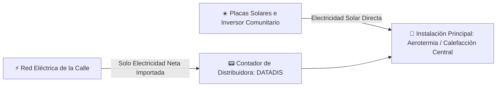
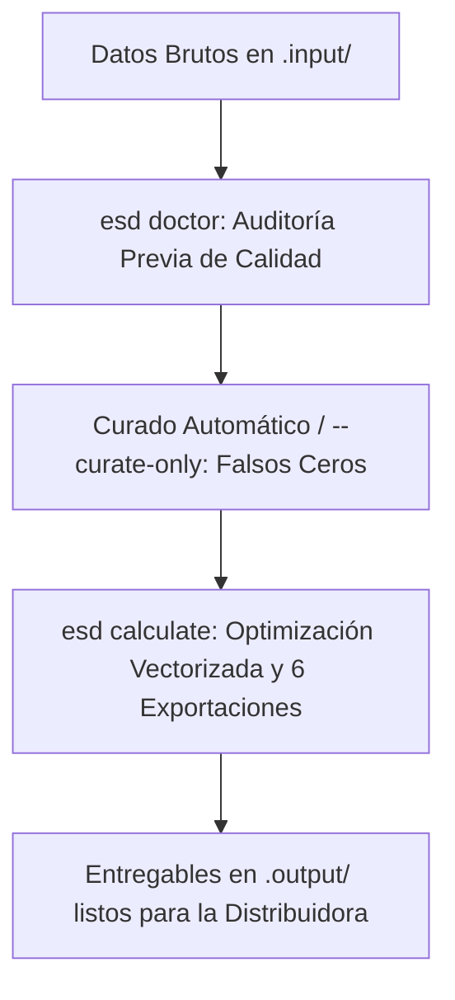

# 📘 Guía Práctica y de Funcionamiento (`esd`)

> **A quién va dirigida esta guía:** Comunidades de propietarios, administradores de fincas, juntas de gobierno, consultores energéticos e ingenieros que desean comprender el análisis energético comunitario y el reparto del autoconsumo solar colectivo entre los servicios comunes de un edificio, sin fórmulas matemáticas complejas ni jerga jurídica confusa.

---

> [!IMPORTANT]
> ### 🛡️ Arnés de Mantenimiento para Desarrolladores y Agentes IA
> **Aviso para ingenieros y agentes autónomos:** Este documento constituye la referencia conceptual y operativa principal de `electricity-share-distributor`. Cada vez que se modifiquen esquemas de ingesta ([`src/ingestion/`](../src/ingestion)), lógica de curado ([`src/curation/`](../src/curation)), optimización ([`src/optimization/`](../src/optimization)), comandos CLI ([`src/cli.py`](../src/cli.py)), vistas en consola ([`src/presentation/views/`](../src/presentation/views)) o exportadores ([`src/presentation/export.py`](../src/presentation/export.py)), **DEBE** actualizarse en tándem esta guía (`GUIDE_ES.md`) y su equivalente en inglés (`GUIDE_EN.md`).

---

## 1. 🎯 ¿Cuál es el Propósito Real de `esd`?

`electricity-share-distributor` (`esd`) es una **plataforma CLI unificada** de **análisis energético y reparto óptimo de autoconsumo fotovoltaico** para los **servicios e instalaciones comunes de una misma comunidad de propietarios** en España. Presta servicio tanto a comunidades que auditan únicamente consumos DATADIS (`esd summary`, `esd compare`) como a comunidades con planta solar colectiva (`esd doctor`, `esd calculate`) bajo el Real Decreto 244/2019 y la Orden TED/1247/2021.

### 🚫 Lo que `esd` NO es
- **`esd` NO está concebido para repartir energía solar ni facturas entre viviendas privadas o pisos particulares de vecinos.**
- No calcula repartos para consumos domésticos individuales ni facturaciones privadas de inquilinos.

### 🏢 Lo que `esd` SÍ es
Cuando una comunidad monitoriza sus contratos generales o instala paneles solares en cubierta, `esd` evalúa la demanda de **sus propias zonas e instalaciones comunes** y distribuye entre ellas la generación solar:
1. **Aerotermia Central / Calefacción y Agua Caliente (*Aerotermia / Calefacción Central / ACS*):** Por lo general, el mayor centro de consumo térmico de los edificios modernos.
2. **Piscina Comunitaria y Sala Social (*Piscina y Sala Comunitaria*):** Motores de filtración, depuradoras, iluminación estival y consumo de sala vecinal.
3. **Garajes Subterráneos (*Garaje*):** Sistemas de ventilación forzada continua, extractores de monóxido de carbono e iluminación permanente 24/7.
4. **Zonas Comunes, Escaleras y Ascensores (*Ascensores, escaleras, alumbrado general*):** Iluminación LED de accesos, telefonillos y motores de tracción de ascensores.

---

## 2. ⚖️ ¿Por qué una Comunidad Necesita Coeficientes si Todo Pertenece a la Misma Finca?

Aunque todos estos servicios pertenecen exactamente a la misma *comunidad de propietarios*, la normativa eléctrica española exige tratar cada servicio común como un **punto de suministro independiente con su propio contrato y contador eléctrico (CUPS)**. Bajo el **Real Decreto 244/2019** y la **Orden TED/1247/2021**:
- La comunidad debe registrar ante la distribuidora un acuerdo formal con el porcentaje ($\beta_i$) de energía solar horaria asignado a cada contador comunitario.
- La suma de coeficientes entre todos los suministros comunes participantes debe alcanzar **estrictamente el 100%** ($\sum \beta_i = 1,0$).
- En la modalidad mensual estándar, los coeficientes permanecen constantes durante todo el mes natural; de forma alternativa, puede presentarse un perfil diario de 24 horas bajo la **Orden TED/1247/2021**.

### Por qué el Reparto Ingenuo Provoca Grandes Pérdidas Económicas
Dividir la electricidad solar a partes iguales (p. ej., $12,5\%$ entre 8 contadores) o según el importe de la factura anual genera un enorme despilfarro estacional y horario:
- **Desajuste Estacional (Piscina frente a Calefacción):** En enero, la depuradora de piscina permanece apagada mientras la aerotermia central trabaja sin descanso para calentar el edificio. Dar cuotas iguales a la piscina en invierno vierte energía solar diurna a precio de excedente mientras la calefacción compra electricidad punta de red.
- **Desajuste Diario (Alumbrado frente a Aerotermia):** La iluminación común demanda mínima potencia base LED e interfonos, mientras los compresores térmicos concentran su consumo al mediodía solar. Analizar curvas horarias permite asignar la generación donde más recorta el recibo comunitario.

---

## 3. 🔍 El Proceso de Curado: Resolviendo el Enigma de los "Falsos Ceros"

Antes de optimizar coeficientes, las instalaciones comunitarias reales afrontan un obstáculo físico habitual: **el contador de la distribuidora marca "falsos ceros" durante las horas de sol** porque las placas solares y el inversor se conectan físicamente detrás del contador de la instalación principal (habitualmente aerotermia central):



1. **Dentro del Edificio:** Durante las horas soleadas, la aerotermia consume directamente la electricidad limpia generada en cubierta sin extraer corriente de la calle.
2. **En el Contador de Distribuidora (DATADIS):** El contador solo registra energía neta importada de la red exterior, marcando **0,0 kWh** cuando el sol satisface la carga.
3. **La Trampa:** Optimizar únicamente con lecturas de distribuidora haría parecer completamente inactivo al mayor consumidor diurno del edificio, quitándole cuota para dársela a circuitos pequeños incapaces de aprovecharla.

### Cómo Reconcilia la Realidad el Pipeline Medallón en 3 Etapas ([`src/curation/`](../src/curation))
`esd calculate` ejecuta el curado automáticamente siempre que `.curated/esd.csv` falte o difiera de `cups.json` (`esd calculate --curate-only` exporta también libros Excel gemelos estilizados):
1. **Etapa 1 — Agregación de Generación (`generation.csv` y `.xlsx` opcional):** Consolida archivos Excel del inversor en `.input/generation/` dentro de un `GenerationDataset` canónico (`timestamp;year;month;day;hour;day_of_week;is_weekend;generation;consumption;self_consumption;exported_energy;imported_energy`).
2. **Etapa 2 — Agregación de Consumo (`consumption.csv` y `.xlsx` opcional):** Consolida CSVs DATADIS en `.input/consumption/` restringidos estrictamente a los CUPS registrados en [`.input/cups/cups.json`](../.input/cups/cups.json), enriquecidos con su etiqueta `use` y excluyendo suministros ajenos en un `ConsumptionDataset` (`timestamp;year;month;day;hour;day_of_week;is_weekend;cups_id;use;consumption`).
3. **Etapa 3 — Archivo Maestro ESD (`esd.csv` y `.xlsx` opcional):** Alinea horas comunes entre generación y consumo para los CUPS de `cups.json` en `CuratedDataset`, resuelve falsos ceros del contador principal, calcula balances colectivos e incorpora el contexto climático horario.

### El Resultado Curado (`.curated/esd.csv` y `.curated/esd.xlsx`)
#### 1. Archivo Maestro CSV Estandarizado (`esd.csv`)
Estructurado con delimitador `;`, coma `,` decimal y sin separador de miles agrupando cuatro bloques lógicos:
1. **Coordenadas temporales:** `timestamp`, `year`, `month`, `day`, `hour`, `day_of_week`, `is_weekend`
2. **Consumidor individual:** `cups_id`, `use`, `consumption`
3. **Balance comunitario y solar:** `community_demand`, `generation`, `self_consumption`, `exported_energy`, `imported_energy`
4. **Contexto meteorológico:** `temperature`, `cloud_cover`

```csv
timestamp;year;month;day;hour;day_of_week;is_weekend;cups_id;use;consumption;community_demand;generation;self_consumption;exported_energy;imported_energy;temperature;cloud_cover
2026-05-01 12:00:00;2026;5;1;12;Friday;False;ES0021000000000001AA;Aerotermia;8,5;9,7;12,5;6,0;6,0;2,5;21,4;12
2026-05-01 12:00:00;2026;5;1;12;Friday;False;ES0021000000000002BB;Garaje;1,2;9,7;12,5;0,0;0,0;0,0;21,4;12
```

#### 2. Libros Excel Estilizados en Streaming (`--curate-only` ➔ `esd.xlsx`, `generation.xlsx`, `consumption.xlsx`)
- **Cabeceras por Grupo Semántico:** Colores armónicos diferencian Tiempo (Azul Pizarra), CUPS (Verde Petróleo), Demanda (Terracota), Solar/Balance (Verde Esmeralda) y Clima (Amatista).
- **Patrón Cebra por Bloque Horario:** Todas las filas de una misma hora comparten fondo, alternando entre blanco puro y un gris suave (`#F4F6F9`) para agrupar los suministros por intervalo.
- **Emojis Booleanos, Paneles Inmovilizados y Autofiltros:** `is_weekend` muestra `✅`/`❌`, cabecera superior fijada y filtros nativos activos.

Para el suministro principal, `esd` adopta $\max(C_{\text{DATADIS}}, C_{\text{inversor}})$ — reconciliación no destructiva que captura la demanda real tras el contador sin sobrescribir jamás lecturas fiscales positivas DATADIS durante caídas de telemetría del inversor. Dicho punto principal recibe además los flujos de balance de planta conservados ($SC_{\text{principal}, h} = \min(G_h, C_{\text{final}, h})$, `exported_energy` e `imported_energy`), asignando cero a los demás suministros antes del reparto colectivo. El conjunto se ordena cronológicamente y alfabéticamente por uso `use`, e integra automáticamente `temperature` (°C) y `cloud_cover` (0–100%) de Open-Meteo desde las coordenadas de `cups.json`.

---

## 4. 🧠 Heurísticas Clave Explicadas de Forma Sencilla

### 1. Detección de Falsos Ceros y Resiliencia ante Caídas de Telemetría
En el suministro principal, el medidor del inversor capta la carga física mientras el autoconsumo tras el contador lleva a cero la lectura DATADIS. Cuatro salvaguardas blindan el cálculo frente a fallos de sensor:
- **Saneamiento de Caídas Parciales:** Si el sensor de producción FV cae a mitad de hora mientras la red registra exportación ($G_{\text{FV}} < E_{\text{exportada}}$), la producción corrupta y el falso cero del inversor se sanean antes de optimizar.
- **Protección contra Ceros por Apagón:** La reconciliación ($\max(C_{\text{DATADIS}}, C_{\text{inversor}})$) nunca sustituye una lectura fiscal positiva DATADIS por un cero provocado por desconexión del registrador.
- **Respaldo Quincenal (`MIN_FORTNIGHT_SOLAR_DAYS = 5`):** Toda quincena (`01-1`..`12-2`) con menos de 5 días solares activos adopta automáticamente los coeficientes $\beta_i$ del mes completo evitando sobreajustes.
- **Auditoría Previa de Apagones (`esd doctor`):** Emite advertencia automática cuando la serie solar presenta $\ge 48$ horas consecutivas a cero.

### 2. Calendario Previsional de Futuro (Enero a Diciembre)
Las comunidades presentan acuerdos ante la distribuidora para el **año operativo entrante** y no hacia el pasado; por ello `esd` organiza siempre todas las propuestas en una matriz homogénea de enero a diciembre.

### 3. Filtro de Mes Completo (La Regla del 90%)
Si la planta se puso en marcha a mitad de mes (p. ej., un 20 de junio), fijar cuotas mensuales permanentes sobre 10 días distorsionaría el reparto:
- Cada mes histórico debe abarcar de principio a fin superando el día 27 y cubriendo **al menos el 90% de las horas naturales esperadas**.
- Si no supera este umbral de calidad, `esd` lo omite limpiamente mostrando un guion (`—`).

### 4. Agregación Multianual y Escalado por Mes $1/k_m$
El clima varía cada año — un mayo lluvioso en 2025 seguido de un mayo soleado en 2026 no debe sesgar la junta vecinal. Ante múltiples años, `esd` agrupa todas las observaciones completas por mes natural y escala generación solar, demanda, autoconsumo y excedentes por su multiplicidad exacta **$1/k_m$** (número de años completos observados en el mes natural $m$, o quincena/hora equivalente), impidiendo que series desiguales distorsionen el año normalizado.

### 5. Redondeo Exacto al 100% (Método de Restos Mayores / Hare-Niemeyer)
Las distribuidoras rechazan repartos cuya suma difiera del **100% estricto**:
- El redondeo estándar genera frecuentemente sumas de 99% o 101% por acumulación decimal.
- El **Método del Resto Mayor (Hare-Niemeyer)** asigna primero los valores truncados y reparte las unidades sobrantes a los mayores residuos decimales, asegurando sumas **estrictamente del 100%** en precisión `0`, `1` o `2`.

### 6. Perfiles Diurnos Suavizados y Suelo Nocturno del 1%
Un paso fugaz de nubes puede inflar porcentajes brutos en cargas intermitentes como motores de ascensor. En `esd calculate`, el motor horario de 24h consolida todos los días observados en `share_pct` y el coeficiente suavizado oficial (`estimated_share_pct`, **Orden TED/1247/2021**). En horas nocturnas con generación exactamente cero, cada CUPS mantiene un **suelo activo del 1%** (o su `min_share`) y el resto recae en el CUPS principal (p. ej., 99%/1%), preservando la participación continua al 100%.

### 7. Índice de Eficiencia Solar Fotovoltaica (SEI)
En `*_esd_hourly_shares.csv`, cada hora incorpora el entero `solar_efficiency` (`0` si $G_h = 0$; `1`–`100` con radiación activa) combinando meteorología Open-Meteo y geometría solar:
$$\text{SEI} = \begin{cases} \text{clip}\left(\text{round}\left(100.0 \times f_{\text{cloud}} \times f_{\text{temp}} \times f_{\text{season}} \times f_{\text{hour}}\right), \; 1, \; 100\right) & \text{si } G_h > 0 \\ 0 & \text{si } G_h = 0 \end{cases}$$
- **Atenuación Óptica por Nubosidad ($f_{\text{cloud}}$):** Extinción no lineal manteniendo ~25% de radiación difusa bajo cielos cubiertos: $f_{\text{cloud}} = 1.0 - 0.75 \times \left(\frac{CC}{100.0}\right)^{1.2}$.
- **Degradación Térmica de Célula ($f_{\text{temp}}$):** Coeficiente térmico de silicio ($-0,4\% / ^\circ\text{C}$ respecto a $20^\circ\text{C}$), mejorando mañanas frías (hasta $+8\%$) y degradando mediodías tórridos: $f_{\text{temp}} = \text{clip}\left(1.0 - 0.004 \times (T_{\text{amb}} - 20.0), \; 0.80, \; 1.08\right)$.
- **Elevación Solar Estacional ($f_{\text{season}}$):** Declinación y masa atmosférica en la Península Ibérica (36°N–43°N, junio ~1,00, dic. ~0,70): $f_{\text{season}} = 0.85 + 0.15 \times \cos\left(\frac{2\pi \times (m - 6.5)}{12.0}\right)$.
- **Ángulo Cénit Diurno ($f_{\text{hour}}$):** Curva de incidencia sobre cubierta fija con pico al mediodía solar (13:00–14:00): $f_{\text{hour}} = \begin{cases} 0.70 + 0.30 \times \sin\left(\pi \times \frac{h - 6.0}{15.0}\right) & \text{si } 6 \le h \le 21 \\ 0.65 & \text{en otro caso} \end{cases}$.

### 8. Restricciones Regulatorias y Límites Estatutarios (*Estatutos de la Comunidad*)
Los estatutos vecinales pueden imponer cuotas límite directamente en `.input/cups/cups.json`:
- **Cuota Mínima (`"min_share"`):** Garantiza a circuitos menores (garajes, ascensores, alumbrado) un suelo mínimo (p. ej., `0.05` = 5%).
- **Cuota Máxima (`"max_share"`):** Impide que un servicio dominante (p. ej., aerotermia) acapare la generación (p. ej., tope `0.70` = 70%).
- **Cumplimiento Uniforme:** El optimizador verifica la factibilidad ($\sum L_i \le 1,0$) e impone $L_i \le \beta_i \le U_i$ junto con el redondeo Hare-Niemeyer en los repartos mensual, quincenal y horario.

### 9. Cambios Horarios DST Europeos y Conservación de Energía en Otoño
La España peninsular aplica el horario de verano europeo (23h el último domingo de marzo y 25h el último domingo de octubre):
- **Hora Repetida en Otoño (`02:00` CEST/CET):** Al atrasar el reloj, tanto DATADIS como el inversor emiten dos lecturas `02:00` en esa fecha.
- **Consolidación Intradía sin Pérdidas ni Duplicados:** Antes de fusionar archivos solapados, `consolidate_autumn_dst` suma ambas lecturas dentro de cada fichero de origen conservando el 100% de la energía otoñal sin duplicaciones entre archivos.

---

## 5. 📊 Balance Energético Comunitario y Progresión en 4 Modalidades

Para brindar total transparencia a juntas de propietarios y administradores, `esd` reporta seis KPIs normalizados y cuatro modalidades operativas en vistas Rich, informes HTML y exportaciones CSV.

### Los Seis Indicadores Clave del Balance Energético
1. **Generación Solar Total ($G_{\text{total}}$):** Kilovatios-hora totales producidos por la planta fotovoltaica en todo el horizonte evaluado.
2. **Demanda Total de la Comunidad ($C_{\text{total}}$):** Consumo eléctrico continuo 24/7 de todos los servicios comunes participantes.
3. **Generación en Horas de Sol ($G_{\text{solar}}$):** Producción en intervalos con radiación solar ($G_h > 0$), certificando ausencia de distorsión nocturna.
4. **Demanda en Horas de Sol ($C_{\text{solar}}$):** Consumo diurno comunitario coincidente con horas solares ($G_h > 0$), definiendo el techo físico instantáneo sin baterías.
5. **Excedentes Vertidos ($Surplus$):** Energía solar instantánea que excede la demanda simultánea ($\max(0, G_h - C_h)$), vertida a la red.
6. **Energía Autoconsumida Total ($SC$):** Kilovatios-hora aprovechados directamente in situ ($\min(C_h, G_h)$), evitando compras minoristas de red.

### Las Cuatro Modalidades de Autoconsumo y su Progresión
Evaluadas de forma homogénea mediante el escalado mensual $1/k_m$:
1. **Autoconsumo Actual (Sin Reparto / Línea Base):** Autoconsumo físico capturado únicamente tras el contador principal en solitario ($SC_{\text{principal}, h}$).
2. **Reparto Mensual Fijo (Real Decreto 244/2019):** Coeficientes fijos mensuales $\beta_{i,m}$ adaptados a ciclos de calefacción invernal y piscina estival.
3. **Reparto Quincenal (24 Quincenas):** Optimización independiente para los días `1–15` y `16–fin` de cada mes (respaldo mensual `MIN_FORTNIGHT_SOLAR_DAYS = 5`).
4. **Reparto Horario Dinámico (Orden TED/1247/2021):** Perfiles diarios de 24h ($\beta_{i,h}$) que maximizan la coincidencia instantánea entre generación y consumo.

---

## 6. 🚀 Flujo Práctico de Uso y Comandos

### Vía A: Analítica Exclusiva de Consumo (`esd summary` y `esd compare`)
Para comunidades sin planta FV (o en fase previa de estudio) bastan CSVs DATADIS en estructura plana (`.input/consumption/*.csv`) o anualizada (`.input/consumption/<año>/*.csv`, admitiendo `consumo_kWh`/`consumoKwh` tras validación con `DatadisValidator`); `cups.json` es opcional para etiquetas `use`:
```bash
esd summary [--year 2025] [--view all|annual|monthly] [--cups ES0021000000000001AA]
esd compare [-y 2024 -y 2025] [--no-charts] [--html]
```
- **Cuotas Exactas al 100,00% e Insignias:** Sumas exactas al `100.00%`; `★` destaca al consumidor líder (`>30%` en rango #1) y `(0)` señala suministros inactivos (`<1 kWh`). (`esd summary` muestra resúmenes compactos por defecto; usa `--view monthly` para desplegar tablas mensuales por CUPS.)
- **Heurística `[Inc]` y Gráficos SVG Nativos:** `esd compare` marca con `[Inc]` meses bajo el 90% de horas o anteriores al día 27 en todos los años comparados, excluyéndolos de totales y deltas, y exporta barras SVG en `.output/charts/` más panel `--html` opcional.

### Vía B: Flujo Completo de Reparto Solar (`esd init` ➔ `esd doctor` ➔ `esd calculate`)


### Paso 1: Inicialización y Configuración (`esd init` / `esd config`)
Crea `.input/`, `.curated/` y `.output/`, y configura idioma (`en`/`es`), decimales (`0`/`1`/`2`), coordenadas Open-Meteo (`--latitude`/`--longitude`), directorios y ruta a `cups.json` (`--cups-file`) una sola vez en `.esd_config.json` (compartido automáticamente por `doctor`, `summary`, `compare`, `calculate` y `clean`):
```bash
esd init [--lang en|es] [--precision 0|1|2]
esd config [--lang es] [--precision 2] [--latitude 40.4168 --longitude -3.7038] [--cups-file .input/cups/cups.json]
```

### Paso 2: Comprobar Salud de Datos (`esd doctor`)
Audita CSVs DATADIS, informes `.xlsx` del inversor solar y archivos meteorológicos para detectar huecos, duplicados, contadores inactivos, apagones prolongados (`>=48h`) y solapamientos. Opera en **modo diagnóstico solo-consumo** si falta generación (`can_calculate=False`, código de salida `1`):
```bash
esd doctor [--verbose]
```

### Paso 3: Curado Automático, Clima y Optimización Solar Colectiva (`esd calculate`)
`esd calculate` se ejecuta apoyándose en tu configuración persistente de `.esd_config.json`, evalúa estrictamente los CUPS participantes definidos en `.input/cups/cups.json`, calcula los coeficientes óptimos mensuales, quincenales (24 periodos de medio mes: días 1–15 y días 16–fin) y horarios de 24 horas mediante *water-filling* vectorizado (verificado frente al solver PL HiGHS de SciPy), presenta tablas resumen, trayectoria y matriz en terminales de 80 columnas, y exporta los **6 entregables en `.output/`**:

> [!TIP]
> **Curado Automático y Descarga Meteorológica Integrada:** No necesitas ejecutar comandos intermedios manuales. Siempre que `.curated/esd.csv` falte o quede desactualizado respecto a `cups.json`, `esd calculate` ejecuta automáticamente el pipeline de curado en 3 etapas y descarga los archivos históricos faltantes de Open-Meteo (deduplicando coordenadas repetidas entre CUPS de la misma finca en `{YYYY}_{lat}_{lon}_weather.csv`). Usa `--refresh` para forzar nueva descarga climática y recura completo, o `--curate-only` para generar solo los datasets `.csv` y libros Excel estilizados en `.curated/`.

Ejemplo de configuración en `.input/cups/cups.json` (solo identificadores sintéticos, con límites estatutarios `min_share`/`max_share` y coordenadas opcionales):
```json
[
  {"cups": "ES0021000000000001AA", "use": "Aerotermia", "primary": true, "latitude": 40.4168, "longitude": -3.7038},
  {"cups": "ES0021000000000002BB", "use": "Garaje", "min_share": 0.05, "max_share": 0.40}
]
```

```bash
esd calculate                 # Curado automático + optimización + 6 entregables
esd calculate --refresh       # Descarga meteorológica + recura forzada + cálculo
esd calculate --curate-only   # Genera CSV y libros Excel estilizados en .curated/
```

### Paso 4: Limpiar Archivos Generados (`esd clean`)
Elimina recursivamente archivos generados en `.output/`, `.curated/` e `.input/weather/` preservando archivos ocultos como `.gitkeep`:
```bash
esd clean [--force]
```

---

## 7. 📊 Entregables e Informes Oficiales (`.output/`)

| Nombre de Archivo | Formato | Comando de Origen y Utilidad Práctica |
| :--- | :--- | :--- |
| `*_esd_interactive_report.html` | HTML (Independiente) | `calculate`: Cuadro de mando ejecutivo interactivo offline ES/EN con 4 tarjetas KPI, perfil horario 24h (Orden TED/1247/2021), barras de trayectoria, gráfico SEI y mapa de calor mensual. |
| `*_esd_monthly_shares.csv` | CSV (`;`) | `calculate`: Desglose mensual completo por CUPS: consumo, generación, porcentaje ($\beta_i$ %), kWh autoconsumidos, excedentes y demanda residual, ordenado por mes y `use`. |
| `*_esd_monthly_shares_lite.csv` | CSV (`;`) | `calculate`: Matriz mensual compacta con porcentajes de reparto $\beta_i$ % (`cups`, `use` en eje Y frente a meses `01`..`12` en eje X). |
| `*_esd_fortnight_shares.csv` | CSV (`;`) | `calculate`: Desglose quincenal completo (`1`: días 1–15, `2`: días 16–fin) y balance energético por CUPS. |
| `*_esd_fortnight_shares_lite.csv` | CSV (`;`) | `calculate`: Matriz quincenal compacta con porcentajes de reparto $\beta_i$ % (`cups`, `use` frente a quincenas `01-1`..`12-2`). |
| `*_esd_hourly_shares.csv` | CSV (`;`) | `calculate`: Serie temporal horaria con consumo, producción, cuotas (suelo activo del 1%) e Índice de Eficiencia Solar entero (`0`–`100`). |
| `*_esd_consumption_summary.md` | Markdown | `summary`: Informe ejecutivo con cuotas anuales/mensuales exactas al 100.00%, insignias `★`/`(0)`, barras ASCII y estacionalidad. |
| `*_esd_consumption_comparison.md` y `charts/*.svg` | Markdown + SVG Nativo | `compare`: Informe interanual homogéneo excluyendo meses `[Inc]`, gráficos SVG agrupados en `.output/charts/` y panel `--html` opcional (`*_esd_comparison_report.html`). |

---

## 8. 🗺️ Mapa de Código y Referencia de Trazabilidad

| Capa Arquitectónica | Módulo | Clases / Funciones Clave | Responsabilidad |
| :--- | :--- | :--- | :--- |
| **CLI y Comandos** | [`src/cli.py`](../src/cli.py) | `init_command`, `doctor_command`, `summary_command`, `compare_command`, `calculate_command`, `config_command`, `clean_command` | Enrutamiento Typer perezoso de 7 comandos, `-V`/`-h` y control de flujo. |
| **Servicios de Aplicación** | [`src/services/`](../src/services) | `CalculationService`, `SummaryService`, `ComparisonService`, `CurationService`, `DoctorService`, `WeatherService` | Orquestadores de negocio desacoplados de la capa de consola. |
| **Analítica de Consumo** | [`src/analytics/`](../src/analytics) | `aggregate_consumption`, `compare_years`, `get_complete_months` | Reparto exacto al 100.00% y motor comparativo interanual `[Inc]`. |
| **Núcleo de Dominio** | [`src/domain/`](../src/domain) | `SupplyPoint`, `BylawConstraints`, `EsdError` | Modelos de dominio puros, cotas estatutarias y excepciones tipadas. |
| **Configuración e Idioma** | [`src/config.py`](../src/config.py), [`src/i18n.py`](../src/i18n.py) | `AppConfig`, `load_config`, `t()`, `TRANSLATIONS` | Persistencia `.esd_config.json`, rutas y espacios de nombres EN/ES. |
| **Ingesta: Consumo** | [`src/ingestion/consumption.py`](../src/ingestion/consumption.py) | `DatadisConsumptionLoader`, `DatadisValidator` | Prevalidación, descubrimiento `<año>/`, conservación DST y lectura CSV. |
| **Ingesta: Producción** | [`src/ingestion/generation.py`](../src/ingestion/generation.py) | `HuaweiGenerationLoader` | Lectura streaming read-only de `.xlsx` (producción FV, carga y DST). |
| **Ingesta: Clima y Auditoría** | [`src/ingestion/weather.py`](../src/ingestion/weather.py), [`doctor.py`](../src/ingestion/doctor.py) | `OpenMeteoWeatherDownloader`, `WeatherLoader`, `DataDoctor` | Descargas Open-Meteo, ingesta climática y auditoría de huecos/solapes. |
| **Curado y Alineación** | [`src/curation/`](../src/curation), [`aligner.py`](../src/ingestion/aligner.py) | `DataCurator`, `TimeSeriesAligner`, `GenerationDataset`, `ConsumptionDataset`, `CuratedDataset` | Agregación en 3 etapas, reconciliación principal, clima y exportación `.curated/`. |
| **Optimización** | [`src/optimization/`](../src/optimization) | `DistributionOptimizer`, `CoefficientsMatrix`, `HourlyProfileMatrix` | Solver vectorizado *water-filling* (verificado HiGHS), $1/k_m$, 4 vías y Hare-Niemeyer. |
| **Presentación y Exportación** | [`src/presentation/`](../src/presentation) | `views/`, `charts.py`, `html_report.py`, `ReportExporter` | Vistas perezosas PEP 562 de 80 cols, SVG, informe HTML y `.xlsx`/CSV/MD. |
| **Seguridad y Versionado** | [`src/security.py`](../src/security.py), [`src/version.py`](../src/version.py) | `check_privacy`, `scan_xlsx_file`, `scan_git_history`, `bump` | Auditoría RGPD de CUPS/coordenadas/rutas/secretos y gestor CalVer. |
