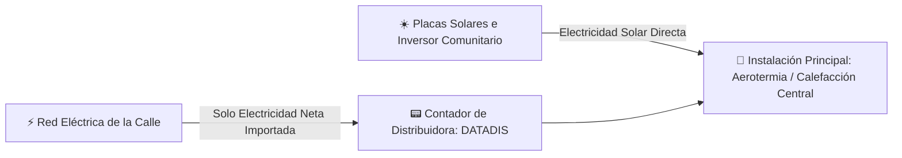
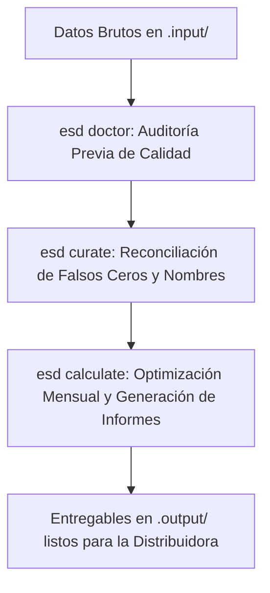

# 📘 Guía Práctica y de Funcionamiento (`esd`)

> **A quién va dirigida esta guía:** Comunidades de propietarios, administradores de fincas, juntas de gobierno, consultores energéticos e ingenieros que desean comprender cómo funciona el reparto del autoconsumo colectivo entre los servicios e instalaciones comunes de un edificio, sin fórmulas matemáticas complejas ni jerga jurídica confusa.

---

> [!IMPORTANT]
> ### 🛡️ Arnés de Mantenimiento para Desarrolladores y Agentes IA
> **Aviso para ingenieros, desarrolladores y agentes autónomos:**
> Este documento representa la referencia conceptual y operativa fundamental de `electricity-share-distributor`.
> Cada vez que se modifiquen los esquemas de ingesta ([`src/ingestion/`](../src/ingestion)), la lógica de curado ([`src/curation/`](../src/curation)), los modelos de optimización ([`src/optimization/`](../src/optimization)), las tablas en consola ([`src/presentation/views.py`](../src/presentation/views.py)) o los exportadores de archivos ([`src/presentation/export.py`](../src/presentation/export.py)), **DEBE** actualizarse esta guía (`GUIDE_ES.md`) y su equivalente en inglés (`GUIDE_EN.md`) de forma sincronizada.

---

## 1. 🎯 ¿Cuál es el Propósito Real de `esd`?

`electricity-share-distributor` (`esd`) está diseñado específicamente para calcular los coeficientes de reparto óptimos ($\beta_i$) de una instalación solar fotovoltaica entre los **servicios comunes e instalaciones generales de una misma comunidad de propietarios** en España.

### 🚫 Lo que `esd` NO es:
- **`esd` NO está concebido para repartir energía solar entre viviendas privadas o pisos particulares de vecinos.**
- No calcula repartos para consumos domésticos individuales ni facturaciones privadas de inquilinos.

### 🏢 Lo que `esd` SÍ es:
Cuando una comunidad de propietarios instala paneles solares en la cubierta, la comunidad utiliza la electricidad generada para abastecer **sus propias zonas e instalaciones comunes**, tales como:
1. **Aerotermia Central / Calefacción y Agua Caliente (*Aerotermia / Calefacción Central / ACS*):** Por lo general, el mayor centro de consumo eléctrico de los edificios modernos.
2. **Piscina Comunitaria y Sala Social (*Piscina y Sala Comunitaria*):** Motores de filtración, depuradoras, iluminación y consumo estival.
3. **Garajes Subterráneos (*Garaje*):** Sistemas de ventilación forzada continua, detectores y extractores de monóxido y alumbrado permanente.
4. **Zonas Comunes, Escaleras y Ascensores (*Ascensores, escaleras, alumbrado general*):** Iluminación de accesos, telefonillos y tracción de ascensores.

---

## 2. ⚖️ ¿Por qué una Comunidad Necesita Coeficientes si Todo Pertenece a la Misma Finca?

Aunque todos estos servicios pertenecen a la misma comunidad de propietarios, la normativa del sector eléctrico español exige que cada servicio común opere como un **punto de suministro independiente, con su propio contrato de acceso y su propio contador eléctrico (CUPS)**.

Bajo el **Real Decreto 244/2019** y la **Orden TED/1247/2021**:
- La comunidad debe registrar ante la compañía distribuidora un acuerdo formal con el porcentaje ($\beta_i$) de la energía solar generada cada hora asignado a cada contador comunitario.
- La suma de los coeficientes entre todos los suministros comunes participantes debe ser **estrictamente del 100%** ($\sum \beta_i = 1,0$).
- En la modalidad mensual estándar, estos coeficientes son fijos durante todo el mes natural. De forma alternativa, se puede presentar un perfil diario de 24 horas según la Orden TED/1247/2021.

### Por qué el Reparto Ingenuo Provoca Grandes Pérdidas Económicas:
Podría parecer sencillo repartir la energía solar a partes iguales (por ejemplo, el $12,5\%$ a cada uno de 8 contadores comunitarios) o según el gasto de la factura anual. Sin embargo, esto provoca un enorme despilfarro:
- **El Desajuste Estacional (Piscina frente a Calefacción):** En enero, la depuradora de la piscina está apagada o funciona mínimos minutos al día, mientras que las bombas de calor de la aerotermia central trabajan sin descanso para calentar el edificio. Asignar cuotas solares a la piscina en invierno vierte esa valiosa energía a la red de la calle como excedente a precio de saldo, mientras la calefacción central se ve forzada a comprar electricidad carísima de la red.
- **El Desajuste Diario (Alumbrado frente a Garajes y Aerotermia):** La iluminación común consume muy poca potencia base (luces LED de bajo consumo e interfonos), mientras que la aerotermia central tiene grandes picos de compresores en las horas centrales del día. Un reparto a partes iguales deja a los circuitos de alumbrado con excedentes solares desaprovechados y deja desabastecida a la calefacción central.

**Cómo lo soluciona `esd`:** El motor de optimización analiza las curvas horarias de todos los suministros comunitarios y calcula matemáticamente los coeficientes exactos que maximizan el aprovechamiento solar dentro de la comunidad, reduciendo al máximo la factura eléctrica total que pagan los propietarios.

---

## 3. 🔍 El Proceso de Curado: Resolviendo el Enigma de los "Falsos Ceros"

Antes de calcular el reparto, las instalaciones comunitarias reales se enfrentan a un obstáculo físico habitual: **el contador de la distribuidora marca "falsos ceros" durante las horas de sol**.

### Por qué Existen Falsos Ceros
En casi todas las comunidades, las placas solares y el inversor se conectan físicamente justo detrás del contador de la instalación principal (habitualmente la aerotermia central o el cuarto de máquinas):



1. **Dentro del Edificio:** En las horas de sol, la aerotermia se alimenta directamente de la electricidad limpia que baja de las placas de la azotea.
2. **En el Contador de la Distribuidora (DATADIS):** El contador de la calle solo mide la electricidad que entra desde la red exterior. Al cubrirse el consumo internamente con energía solar, el contador de red no detecta paso de corriente y anota **0,0 kWh**.
3. **La Trampa:** Si optimizamos basándonos solo en los datos de la distribuidora, ¡la instalación principal de la comunidad parecería completamente inactiva durante el día! El algoritmo cometería el grave error de quitarle cuota solar al mayor consumidor del edificio para dársela a suministros pequeños (como el alumbrado de accesos) que no tienen capacidad de aprovecharla.

### Cómo Reconcilia la Realidad `esd curate`
El motor de curado ([`src/curation/`](../src/curation)) combina dos fuentes de datos independientes para recuperar el consumo físico real:

1. **Datos de Red (DATADIS):** Consumo horario importado de la red para cada contador comunitario.
2. **Datos del Inversor Solar:** El analizador de energía (*smart meter*) del inversor mide tanto la producción solar como la *demanda eléctrica total real* del equipo conectado a él.
3. **Nombres de Servicios ([`.input/cups/cups.json`](../.input/cups/cups.json)):** Asocia los códigos técnicos CUPS de 20 caracteres con descripciones legibles (ej. `"Aerotermia"`, `"Piscina"`, `"Garaje"`, `"Alumbrado"`), e indica cuál es el punto de conexión principal (`"primary": true`).

Cuando el contador de la calle marca cero (o un valor artificialmente bajo) mientras el inversor certifica que la instalación estuvo funcionando, `esd curate` **reemplaza el falso cero por el consumo físico real de la máquina**.

### El Resultado Curado (`.curated/curated.csv`)
El entregable es una tabla única, estandarizada y limpia (con delimitador `;`, coma `,` para decimales y sin separadores de miles):
```csv
timestamp;generation;cups_id;use;consumption;temperature;cloud_cover
2026-05-01 12:00:00;12,5;ES0021000000000001AA;Aerotermia;8,5;21,4;12
2026-05-01 12:00:00;12,5;ES0021000000000002BB;Garaje;1,2;21,4;12
```
Para el suministro principal de la instalación, `esd` adopta siempre el mayor consumo entre la distribuidora (DATADIS) y el sensor de potencia del inversor solar ($\max(C_{\text{DATADIS}}, C_{\text{inversor}})$). Esto garantiza registrar la demanda real y completa de la instalación eliminando los falsos ceros. El archivo CSV se encuentra ordenado cronológicamente por marca de tiempo (fecha/hora) y, dentro de cada hora, alfabéticamente por uso del suministro. Además, cada intervalo horario incorpora el contexto meteorológico local (`temperature` en °C y porcentaje de nubosidad `cloud_cover` de 0 a 100%). Si los datos meteorológicos no están disponibles localmente en `.input/weather/`, `esd curate` ejecuta automáticamente la consulta a Open-Meteo utilizando la ubicación por defecto de la comunidad en `.input/cups/cups.json`.

---

## 4. 🧠 Heurísticas Clave Explicadas de Forma Sencilla

`esd` incorpora varias reglas prácticas para que los resultados sean fiables y aptos para su presentación oficial ante la distribuidora:

### 1. Detección Inteligente de Falsos Ceros y Adopción del Mayor Consumo Real
En el suministro principal, el contador del inversor mide la carga física real de la maquinaria. En horas con radiación solar, el autoconsumo detrás del contador provoca que la lectura de red de la distribuidora (DATADIS) marque cero o valores artificialmente bajos. Para capturar el consumo completo y proteger frente a caídas temporales de sensores, `esd` adopta siempre $\max(C_{\text{DATADIS}}, C_{\text{inversor}})$, recuperando el consumo oculto y contabilizando los kWh reales.

### 2. Calendario Previsional de Futuro (Enero a Diciembre)
Las comunidades no firman acuerdos para repartir energía en el pasado; necesitan un acuerdo para el **año operativo que entra**. Por ello, `esd` siempre estructura sus propuestas como una matriz anual limpia de enero a diciembre.

### 3. Filtro de Mes Completo (La Regla del 90%)
Si la instalación solar se dio de alta a mitad de mes (por ejemplo, un 20 de junio), optimizar un porcentaje mensual permanente basándose en solo 10 días distorsionaría el reparto de todo el mes.
- `esd` comprueba que cada mes histórico disponga de lecturas continuas desde el principio hasta el final del mes, cubriendo **al menos el 90% de los días y horas naturales**.
- Si un mes no cumple este umbral de calidad, la herramienta lo omite y muestra un guion (`—`) en lugar de arrojar porcentajes basados en datos incompletos.

### 4. Agregación Multianual contra Anomalías Meteorológicas
El clima varía de un año a otro. Un mes de mayo lluvioso en 2025 y un mayo soleado en 2026 no deberían desorientar el acuerdo comunitario. Cuando se dispone de datos del mismo mes en varios años, `esd` combina todas las horas históricas observadas. Esto diluye anomalías temporales y genera un perfil equilibrado y representativo a largo plazo.

### 5. Redondeo Exacto al 100% (Método de Restos Mayores / Hare-Niemeyer)
Las distribuidoras eléctricas rechazan de plano las tablas de coeficientes si la suma de porcentajes no da **exactamente el 100%**.
- El redondeo estándar genera habitualmente sumas de 99% o 101% por acumulación de decimales.
- `esd` utiliza el **Método del Resto Mayor** (Hare-Niemeyer): asigna primero la parte entera de cada porcentaje a cada servicio comunitario y luego reparte los decimales sobrantes a los suministros con mayores restos decimales hasta alcanzar **estrictamente el 100%** en cualquier precisión (0, 1 o 2 decimales).

### 6. Perfiles Horarios Diarios y Asignación Nocturna
En días de tormenta, la producción solar puede caer bruscamente. Si los motores del ascensor arrancan en un momento puntual de sol débil, calcular porcentajes instantáneos en ese día le asignaría un porcentaje desproporcionado (como el 95%) que no refleja su patrón habitual.
- El perfil diario de 24 horas (`--hourly`) calcula el patrón típico consolidado en todos los días observados.
- Ofrece tanto el porcentaje horario real (`share_pct`) como el porcentaje estimado regulatorio (`estimated_share_pct`) conforme a la Orden TED/1247/2021.
- **Horas nocturnas con producción exactamente cero:** En las horas nocturnas sin ninguna producción solar, se asigna siempre el 100% del reparto al CUPS principal de la instalación (y 0% al resto de servicios). Esto evita repartir cuotas ficticias de energía inexistente entre circuitos menores de alumbrado o auxiliares, garantizando a la vez una suma reglamentaria exactamente del 100%.

### 7. Índice de Eficiencia Solar Fotovoltaica (SEI)
En el cálculo horario (`--hourly`), cada fila incorpora una métrica dedicada de `solar_efficiency` (escala 1,0 a 100,0) calculada **estrictamente para las horas con generación solar activa** ($G_h > 0$). Durante la noche o en intervalos con generación nula, el campo permanece vacío.

El índice modela el rendimiento físico fotovoltaico y la geometría óptica solar a partir de los datos meteorológicos locales de Open-Meteo:
$$\text{SEI} = \text{clip}\left(100.0 \times f_{\text{cloud}} \times f_{\text{temp}} \times f_{\text{season}} \times f_{\text{hour}}, \; 1.0, \; 100.0\right)$$

- **Atenuación Óptica por Nubosidad ($f_{\text{cloud}}$):** Modela la extinción no lineal de la radiación directa a través de capas nubosas, reteniendo aproximadamente un 25% de radiación difusa incluso bajo cielos completamente cubiertos:
  $$f_{\text{cloud}} = 1.0 - 0.75 \times \left(\frac{CC}{100.0}\right)^{1.2}$$
- **Degradación Térmica de Célula ($f_{\text{temp}}$):** Reproduce el coeficiente térmico de potencia característico de las células de silicio ($-0,4\% / ^\circ\text{C}$ respecto a $20^\circ\text{C}$ ambiente de referencia). Mañanas frías y despejadas ofrecen una mejora de rendimiento (hasta $+8\%$), mientras que el calor extremo del mediodía estival degrada la tensión de los paneles:
  $$f_{\text{temp}} = \text{clip}\left(1.0 - 0.004 \times (T_{\text{amb}} - 20.0), \; 0.80, \; 1.08\right)$$
- **Elevación Solar Estacional ($f_{\text{season}}$):** Modela la declinación solar anual y la masa de aire atmosférica en latitudes de la Península Ibérica (36°N–43°N), alcanzando su cénit en el solsticio de verano (junio/julio ~ 1,00) y su mínimo en el de invierno (diciembre/enero ~ 0,70):
  $$f_{\text{season}} = 0.85 + 0.15 \times \cos\left(\frac{2\pi \times (m - 6.5)}{12.0}\right)$$
- **Ángulo Cénit Diurno ($f_{\text{hour}}$):** Refleja la curva diurna de elevación solar y el ángulo de incidencia sobre paneles de cubierta con inclinación fija, alcanzando el máximo en el mediodía solar (13:00–14:00 en España) con mínimas pérdidas por reflexión de Fresnel, y reduciéndose en horas rasantes:
  $$f_{\text{hour}} = \begin{cases} 0.70 + 0.30 \times \sin\left(\pi \times \frac{h - 6.0}{15.0}\right) & \text{si } 6 \le h \le 21 \\ 0.65 & \text{en otro caso} \end{cases}$$

---

## 5. 🚀 Flujo Práctico de Uso y Comandos

El proceso completo se ejecuta de forma sencilla mediante la consola:



### Paso 1: Comprobar la Salud de los Datos (`esd doctor`)
Revisa todos los archivos CSV de DATADIS y los informes Excel del inversor solar para detectar huecos, contadores inactivos y solapamientos antes de realizar cálculos:
```bash
esd doctor
```

### Paso 2: Curado Automático o Manual (`esd curate`)
Reconcilia los falsos ceros del contador principal y genera `.curated/curated.csv`:
```bash
esd curate
```
> [!TIP]
> **Curado Automático:** ¡Ni siquiera es necesario ejecutar `esd curate` manualmente! Al ejecutar `esd calculate`, la herramienta detecta si `.curated/curated.csv` existe y, si no está presente, lanza el curado de forma automática.

### Paso 3: Descarga de Datos Meteorológicos Horarios (`esd weather`)
Descarga datos meteorológicos históricos horarios (temperatura, nubosidad, códigos meteorológicos OMM) de Open-Meteo en `.input/weather/{YYYY}_{lat}_{lon}_weather.csv`. El año es el único parámetro obligatorio: si no se proporcionan coordenadas en la CLI, `esd weather` inspecciona automáticamente `cups.json`, deduplica las ubicaciones repetidas entre servicios de un mismo edificio y descarga cada coordenada única una sola vez:
```bash
# Descarga automática para todas las ubicaciones únicas definidas en cups.json
esd weather --year 2024

# O especificar coordenadas personalizadas de forma explícita
esd weather --year 2024 --latitude 40.4168 --longitude -3.7038
```

### Paso 4: Calcular el Reparto Comunitario Óptimo (`esd calculate`)
Resuelve el reparto óptimo y presenta tablas claras adaptadas a terminales de 80 columnas:
```bash
# Calcular el calendario completo de 12 meses
esd calculate

# Filtrar para un año y mes específicos
esd calculate --year 2026 --month 5

# Incluir perfil horario de 24 horas y serie temporal horaria completa
esd calculate --hourly

# Configurar la precisión decimal de los porcentajes (0 = 53%, 1 = 52.8%, 2 = 52.86%)
esd calculate --precision 1
```

---

## 6. 📊 Entregables e Informes Oficiales (`.output/`)

Al ejecutar `esd calculate`, se generan automáticamente los archivos en `.output/`:

| Nombre de Archivo | Formato | Utilidad Práctica |
| :--- | :--- | :--- |
| `*_esd_coefficients_matrix.csv` | CSV (delimitado por `;`) | Tabla en formato hoja de cálculo lista para su presentación oficial ante la compañía distribuidora de electricidad (DSO). |
| `*_esd_optimization_summary.md` | Markdown | Informe ejecutivo completo con el anexo del acuerdo de reparto comunitario listo para la firma de la junta de propietarios. |
| `*_esd_coefficients.csv` | CSV (delimitado por `;`) | Desglose detallado por CUPS: kWh autoconsumidos, excedentes vertidos y demanda remanente de red. |
| `*_esd_results.json` | JSON | Archivo de datos estructurado para integraciones informáticas o cuadros de mando comunitarios. |
| `*_esd_hourly_shares.csv` | CSV (delimitado por `;`) | Serie temporal horaria con consumo, producción, cuotas y el Índice de Eficiencia Solar (1-100 en horas de generación), ordenada por fecha y uso. |
| `*_esd_hourly_profile_matrix.csv` | CSV (delimitado por `;`) | Tabla diaria de 24 horas para presentar coeficientes variables según la Orden TED/1247/2021. |

---

## 7. 🗺️ Mapa de Código y Referencia de Trazabilidad

Para desarrolladores y agentes autónomos que naveguen por la base de código:

| Capa Arquitectónica | Módulo | Clases / Funciones Clave | Responsabilidad |
| :--- | :--- | :--- | :--- |
| **CLI y Comandos** | [`src/cli.py`](../src/cli.py) | `calculate_command`, `curate_command`, `weather_command`, `doctor_command` | Enrutamiento de comandos Typer, validación de parámetros y flujo de ejecución. |
| **Configuración** | [`src/config.py`](../src/config.py) | `AppConfig`, `get_language`, `get_precision`, `get_weather_dir` | Persistencia de ajustes (`.esd_config.json`) y resolución de rutas. |
| **Localización** | [`src/i18n.py`](../src/i18n.py) | `t()`, `TRANSLATIONS` | Diccionario bilingüe inglés/español con soporte de interpolación. |
| **Ingesta: Consumo** | [`src/ingestion/consumption.py`](../src/ingestion/consumption.py) | `DatadisConsumptionLoader` | Búsqueda de CSVs de DATADIS, detección de codificación y lectura. |
| **Ingesta: Producción** | [`src/ingestion/generation.py`](../src/ingestion/generation.py) | `SolarGenerationLoader` | Procesamiento de informes `.xlsx` del inversor solar (producción y demanda). |
| **Ingesta: Meteorología** | [`src/ingestion/weather.py`](../src/ingestion/weather.py) | `OpenMeteoWeatherDownloader`, `WeatherLoader` | Descargador API Open-Meteo Archive, códigos OMM e ingesta de CSV meteorológicos. |
| **Ingesta: Auditoría** | [`src/ingestion/doctor.py`](../src/ingestion/doctor.py) | `DataDoctor`, `DoctorReport` | Diagnóstico de huecos, detección de contadores inactivos y solapamientos. |
| **Curado y Reconciliación** | [`src/curation/`](../src/curation) | `DataCurator`, `CuratedDataset` | Reconciliación de falsos ceros, cruce de metadatos de CUPS y exportación CSV. |
| **Optimización: Modelos** | [`src/optimization/models.py`](../src/optimization/models.py) | `CoefficientsMatrix`, `HourlyProfileMatrix`, `OptimizationResult` | Estructuras matriciales, perfiles horarios diarios y métricas comunitarias. |
| **Optimización: Solver** | [`src/optimization/engine.py`](../src/optimization/engine.py) | `DistributionOptimizer` | Programación lineal (HiGHS), perfil horario, comparativas y redondeo Hare-Niemeyer. |
| **Presentación: Vistas** | [`src/presentation/views.py`](../src/presentation/views.py) | `render_coefficients_matrix_table`, `render_weather_result` | Tablas Rich en consola, maquetación de 80 columnas y resúmenes de curado. |
| **Presentación: Exportación** | [`src/presentation/export.py`](../src/presentation/export.py) | `export_all`, `export_hourly_shares_csv` | Generación de informes en Markdown, hojas CSV y exportación a JSON. |
| **Seguridad y Privacidad** | [`src/security.py`](../src/security.py) | `CupsPrivacyChecker`, `scan_git_history` | Control de cumplimiento RGPD y verificación de CUPS sintéticos. |
