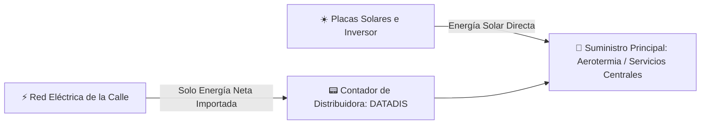
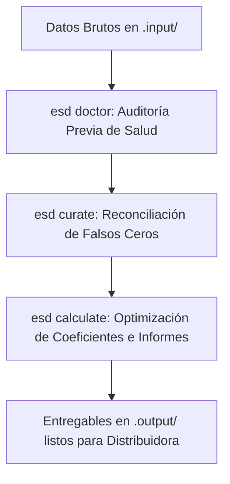

# 📘 Guía Práctica y de Funcionamiento (`esd`)

> **A quién va dirigida esta guía:** Comunidades de propietarios, administradores de fincas, consultores energéticos y desarrolladores que desean comprender cómo funciona el reparto del autoconsumo colectivo en la práctica, sin necesidad de lidiar con fórmulas matemáticas complejas ni lenguaje regulatorio indescifrable.

---

> [!IMPORTANT]
> ### 🛡️ Arnés de Mantenimiento para Desarrolladores y Agentes IA
> **Aviso para ingenieros, desarrolladores y agentes autónomos:**
> Este documento representa la referencia conceptual y operativa fundamental de `electricity-share-distributor`.
> Cada vez que se modifiquen los esquemas de ingesta ([`src/ingestion/`](../src/ingestion)), la lógica de curado ([`src/curation/`](../src/curation)), los modelos de optimización ([`src/optimization/`](../src/optimization)), las tablas en consola ([`src/presentation/views.py`](../src/presentation/views.py)) o los exportadores de archivos ([`src/presentation/export.py`](../src/presentation/export.py)), **DEBE** actualizarse esta guía (`GUIDE_ES.md`) y su equivalente en inglés (`GUIDE_EN.md`) de forma sincronizada.

---

## 1. 🎯 ¿Qué es el Autoconsumo Colectivo y por qué Necesitamos Optimización?

Cuando una comunidad de vecinos en España instala paneles solares en la azotea bajo el **Real Decreto 244/2019**, todos los puntos de suministro participantes (cada uno identificado por su código único de contador o **CUPS**) comparten la electricidad generada por esa única instalación fotovoltaica.

### La Regla Regulatoria: Porcentajes Fijos Mensuales
La normativa eléctrica española exige que los participantes firmen un acuerdo con un porcentaje de reparto fijo para cada mes natural:
- Cada vecino recibe su porcentaje acordado de lo que produzcan las placas solares en cada hora.
- La suma de los porcentajes de todos los vecinos debe ser **exactamente del 100%**.
- Una vez fijados, estos porcentajes permanecen constantes durante todo el mes natural.

### Por qué el Reparto Sencillo Falla en la Práctica
Podría parecer tentador repartir la energía a partes iguales (por ejemplo, el 25% a cada uno entre 4 vecinos) o en función de la factura eléctrica mensual total. Sin embargo, esto provoca una pérdida económica notable:
- **El Problema del Piso Vacío:** Si un vecino pasa el día fuera trabajando o viaja con frecuencia, su cuota solar asignada a las 13:00 se desaprovecha. Se vierte a la red eléctrica de la calle como excedente, pagado a precios mayoristas muy bajos.
- **El Problema del Consumo Diurno:** En ese mismo instante, otro vecino teletrabajando o la aerotermia central se ven obligados a comprar electricidad cara a la distribuidora porque su cuota solar asignada fue insuficiente.

**Cómo lo soluciona `esd`:** La herramienta analiza las curvas históricas hora por hora y encuentra de forma automática los porcentajes de reparto que maximizan la energía solar consumida dentro del edificio, minimizando la electricidad que hay que comprar de la calle.

---

## 2. 🔍 El Proceso de Curado: Resolviendo el Enigma de los "Falsos Ceros"

Antes de calcular cuotas justas, nos encontramos con un problema fundamental en los datos reales: **el contador de la compañía eléctrica miente durante las horas de sol**.

### Por qué Existen "Falsos Ceros" en los Datos de Red
En prácticamente todas las instalaciones comunitarias, las placas solares y el inversor se conectan físicamente justo detrás de un contador principal (por ejemplo, los servicios centrales del edificio, la aerotermia o los ascensores):



1. **Dentro del Edificio:** Durante las horas de sol, la aerotermia consume directamente la electricidad que baja de las placas de la cubierta.
2. **En el Contador de la Distribuidora (DATADIS):** El contador de la compañía solo mide la energía que entra desde la calle. Como la demanda se satisface internamente con energía solar, el contador de la calle no ve pasar corriente y registra **0,0 kWh**.
3. **La Trampa:** Si calculamos el reparto usando únicamente los datos de DATADIS, el suministro principal parece completamente inactivo durante el día. La herramienta cometería el error de quitarle cuota solar al mayor consumidor del edificio para dársela a otros suministros que no la pueden aprovechar.

### Cómo Reconcilia la Realidad `esd curate`
El motor de curado ([`src/curation/`](../src/curation)) cruza dos fuentes de datos independientes para recuperar el consumo físico real:

1. **Datos de Red (DATADIS):** El consumo horario importado de la red para cada vecino.
2. **Datos del Inversor Solar (Huawei FusionSolar):** El inversor registra tanto la producción de las placas como el *consumo real* del equipo conectado a él.
3. **Nombres Descriptivos ([`.input/cups/cups.json`](../.input/cups/cups.json)):** Asocia los códigos técnicos CUPS de 20 caracteres con descripciones legibles (ej. `"Aerotermia"`, `"Piscina"`, `"Garaje"`, `"Portal 1"`), e identifica cuál es el punto de conexión principal (`"primary": true`).

Cuando el contador de la calle marca cero (o un valor artificialmente bajo) mientras el inversor certifica que el equipo estuvo funcionando a pleno rendimiento, `esd curate` **reemplaza el falso cero por el consumo físico real**.

### El Resultado Curado (`.curated/curated.csv`)
El entregable es una tabla única, estandarizada y limpia:
```csv
timestamp,generation,cups_id,use,consumption,primary,reconciled
2026-05-01 12:00:00,12.5,ES0021000000000001AA,Aerotermia,8.5,True,True
2026-05-01 12:00:00,12.5,ES0021000000000002BB,Garaje,1.2,False,False
```
Cada fila indica con total transparencia si la lectura fue reconciliada, garantizando un registro auditable.

---

## 3. 🧠 Heurísticas Clave Explicadas de Forma Sencilla

`esd` incorpora varias reglas prácticas para que los resultados sean fiables frente a las imperfecciones del mundo real:

### 1. Detección Inteligente de Falsos Ceros tras Inversor
En el suministro principal, siempre que el inversor registra consumo activo durante las horas de producción solar, `esd` comprueba si el contador de red marcó cero o un valor sustancialmente menor. Si es así, restablece la lectura real del inversor y contabiliza los kWh recuperados.

### 2. Calendario Previsional de Futuro (Enero a Diciembre)
Las comunidades no firman acuerdos para repartir energía en el pasado; necesitan un acuerdo para el **año operativo que entra**. Por ello, `esd` siempre estructura sus propuestas como una matriz anual limpia de enero a diciembre.

### 3. Filtro de Mes Completo (La Regla del 90%)
Si la instalación solar se dio de alta a mitad de mes (por ejemplo, un 20 de junio), optimizar un porcentaje mensual permanente basándose en solo 10 días distorsionaría el reparto de todo el mes.
- `esd` comprueba que cada mes histórico disponga de lecturas continuas desde el principio hasta el final del mes, cubriendo **al menos el 90% de los días y horas naturales**.
- Si un mes no cumple este umbral de calidad, la herramienta lo omite y muestra un guion (`—`) en lugar de arrojar porcentajes basados en datos incompletos.

### 4. Agregación Multianual contra Anomalías Meteorológicas
El clima varía de un año a otro. Un mes de mayo lluvioso en 2025 y un mayo soleado en 2026 no deberían desorientar el acuerdo. Cuando se dispone de datos del mismo mes en varios años, `esd` combina todas las horas históricas observadas. Esto diluye anomalías temporales y genera un perfil equilibrado y representativo a largo plazo.

### 5. Redondeo Exacto al 100% (Método de Restos Mayores / Hare-Niemeyer)
Las distribuidoras eléctricas rechazan los anexos de reparto si los porcentajes de los vecinos no suman **exactamente el 100%**.
- El redondeo convencional a menudo produce sumas de 99% o 101% debido a decimales acumulados.
- `esd` utiliza el **Método del Resto Mayor**: asigna primero la parte entera de cada porcentaje y luego reparte los decimales sobrantes a los CUPS con mayores restos decimales hasta alcanzar **estrictamente el 100%** en cualquier precisión (0, 1 o 2 decimales).

### 6. Perfiles Horarios Diarios Resistentes a Días Nublados
En días de tormenta, la producción solar puede caer bruscamente. Si un vecino enciende el horno en un momento puntual de sol débil, calcular porcentajes instantáneos en ese día le asignaría un porcentaje desproporcionado (como el 95%) que no refleja su patrón habitual.
- El perfil diario de 24 horas (`--hourly`) calcula el patrón típico consolidado en todos los días observados.
- Ofrece el porcentaje horario real y un porcentaje estimado que protege a los vecinos de distorsiones en días nublados.

---

## 4. 🚀 Flujo Práctico de Uso y Comandos

El proceso completo se ejecuta de forma sencilla mediante la consola:



### Paso 1: Auditoría de Datos (`esd doctor`)
Examina los archivos de consumo de DATADIS y los Excel de Huawei antes de operar, alertando de huecos, contadores inactivos o desfases en fechas:
```bash
esd doctor
```

### Paso 2: Curado Manual o Automático (`esd curate`)
Reconcilia los falsos ceros del suministro principal y genera el archivo limpio `.curated/curated.csv`:
```bash
esd curate
```
> [!TIP]
> **Curado Automático:** ¡Ni siquiera es necesario ejecutar `esd curate` por separado! Al lanzar `esd calculate`, la herramienta verifica si ya existe el archivo `.curated/curated.csv`. Si falta, lo genera automáticamente antes de optimizar.

### Paso 3: Cálculo de Coeficientes Óptimos (`esd calculate`)
Resuelve el reparto óptimo y presenta las tablas en terminal de 80 columnas:
```bash
# Calcular el calendario completo de 12 meses
esd calculate

# Filtrar por un año y mes concreto
esd calculate --year 2026 --month 5

# Incluir perfil diario de 24 horas y serie temporal horaria
esd calculate --hourly

# Configurar precisión de decimales (0 = 53%, 1 = 52.8%, 2 = 52.86%)
esd calculate --precision 1
```

---

## 5. 📊 Entregables e Informes Oficiales (`.output/`)

Al ejecutar `esd calculate`, se generan automáticamente los archivos en `.output/`:

| Archivo Generado | Formato | Finalidad Práctica |
| :--- | :--- | :--- |
| `*_esd_coefficients_matrix.csv` | CSV (delimitado por `;`) | Hoja de cálculo con la tabla oficial preparada para presentar ante la empresa distribuidora de electricidad (DSO). |
| `*_esd_optimization_summary.md` | Markdown | Informe ejecutivo que incluye el anexo de acuerdo de reparto listo para la firma de los vecinos. |
| `*_esd_coefficients.csv` | CSV (delimitado por `;`) | Desglose mensual detallado por CUPS: kWh autoconsumidos, excedentes y demanda de red. |
| `*_esd_results.json` | JSON | Estructura de datos completa pensada para integraciones informáticas o cuadros de mando. |
| `*_esd_hourly_shares.csv` | CSV (delimitado por `;`) | Serie temporal horaria con consumo, producción y cuota real frente a cuota estimada. |
| `*_esd_hourly_profile_matrix.csv` | CSV (delimitado por `;`) | Tabla diaria de 24 horas para presentar coeficientes variables según la Orden TED/1247/2021. |

---

## 6. 🗺️ Mapa de Código y Trazabilidad

Para desarrolladores y agentes que examinan o amplían la base de código:

| Capa Arquitectónica | Módulo | Clases / Funciones Clave | Responsabilidad |
| :--- | :--- | :--- | :--- |
| **CLI e Interfaz** | [`src/cli.py`](../src/cli.py) | `calculate_command`, `curate_command`, `doctor_command` | Enrutamiento de comandos Typer, validación de opciones y flujo de ejecución. |
| **Configuración** | [`src/config.py`](../src/config.py) | `AppConfig`, `get_language`, `get_precision` | Ajustes en `.esd_config.json` y resolución de carpetas. |
| **Internacionalización** | [`src/i18n.py`](../src/i18n.py) | `t()`, `TRANSLATIONS` | Diccionarios bilingües inglés/español con interpolación de variables. |
| **Ingesta: Consumo** | [`src/ingestion/consumption.py`](../src/ingestion/consumption.py) | `DatadisConsumptionLoader` | Descubrimiento y lectura de CSV horarios de DATADIS. |
| **Ingesta: Generación** | [`src/ingestion/generation.py`](../src/ingestion/generation.py) | `HuaweiGenerationLoader` | Lectura de Excel `.xlsx` de Huawei FusionSolar (producción y consumo de carga). |
| **Ingesta: Diagnóstico** | [`src/ingestion/doctor.py`](../src/ingestion/doctor.py) | `DataDoctor`, `DoctorReport` | Detección previa de huecos, contadores inactivos y solapes de fechas. |
| **Curado y Reconciliación** | [`src/curation/`](../src/curation) | `DataCurator`, `CuratedDataset` | Reconciliación de falsos ceros, cruce de metadatos de CUPS y exportación a CSV curado. |
| **Optimización: Modelos** | [`src/optimization/models.py`](../src/optimization/models.py) | `CoefficientsMatrix`, `HourlyProfileMatrix`, `OptimizationResult` | Estructuras matriciales, perfiles horarios diarios y métricas comunitarias. |
| **Optimización: Motor** | [`src/optimization/engine.py`](../src/optimization/engine.py) | `DistributionOptimizer` | Motor de optimización, perfiles horarios diarios, comparativas y redondeo Hare-Niemeyer. |
| **Presentación: Vistas** | [`src/presentation/views.py`](../src/presentation/views.py) | `render_coefficients_matrix_table`, `render_community_summary` | Tablas de consola Rich para terminales de 80 columnas y resúmenes de curado. |
| **Presentación: Exportación** | [`src/presentation/export.py`](../src/presentation/export.py) | `export_all`, `export_hourly_shares_csv` | Generación de informes en Markdown, hojas CSV y exportación a JSON. |
| **Seguridad y Privacidad** | [`src/security.py`](../src/security.py) | `CupsPrivacyChecker`, `scan_git_history` | Protección LOPD/RGPD y verificación de identificadores sintéticos. |
